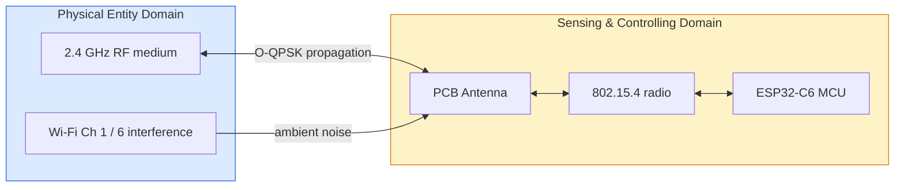

# Design & Decision Record (DDR) — Lab 1: The Radio

**GreenField Technologies — SoilSense Project | IoT Systems Design**  
**Phase:** Feasibility  
**Team:** Edwin Santiago Rodriguez Daza · Jhonatan Yara Lopez

---

## 1. System Overview

- **System Type:** `[x]` Component (Lab 1–2) | `[ ]` System (Lab 3–6) | `[ ]` Environment (Lab 7–8)
- **Hardware Platform:** 2 ESP32-C6 DevKit boards
- **Firmware:** `firmware/lab1_radio` (Zephyr RTOS OpenThread CLI shell, auto-start disabled)
- **Operating Channel:** IEEE 802.15.4 Channel 23 ($2465\text{ MHz}$)
- **Fixed TX Power:** $0\text{ dBm}$ (configured identically on both boards via `ot txpower 0`)
- **Board Identification (`ot extaddr` — Task A Evidence):**
  - **Node A (Leader):** `f4ce36a481c2091a`
  - **Node B (Router):** `f4ce36a481c2092b`

### Overview

An empirical radiofrequency characterization of the ESP32-C6 was performed using IEEE 802.15.4 and OpenThread in the $2.4\text{ GHz}$ ISM band. The goal was to validate field-level link reliability (Packet Error Rate $< 1\%$), identify the cleanest operating channel in the local RF environment, and determine the minimum RSSI threshold that guarantees safe packet delivery before scaling to a multi-node mesh. Both boards were flashed with the Zephyr OpenThread shell, monitored via USB serial/JTAG, scanned across all 16 channels, and evaluated with sequential bidirectional `ot ping` tests across increasing distances.

### Task C — Two-Board Link Verification Evidence

Both boards were configured on Channel 23 at $0\text{ dBm}$ TX power. Node A formed the Thread network as `leader`, and Node B joined using A's active dataset and promoted to `router` before range testing:

```text
# Node A (Leader)
> ot state
leader
Done

> ot neighbor table
| Role | RLOC16 | Age | Avg RSSI | Last RSSI |R|D|N| Extended MAC     | Version |
+------+--------+-----+----------+-----------+-+-+-+------------------+---------+
|   R  | 0x1400 |   4 |      -44 |       -44 |1|1|1| f4ce36a481c2092b |       4 |
Done

# Node B (Router)
> ot state
router
Done
```

Close-range bidirectional pings ($1\text{ m}$) confirmed $0\%$ packet loss and symmetric RSSI ($-42\text{ dBm}$ / $-44\text{ dBm}$) prior to starting the distance sweep.

---

## 2. Lab Log & Stakeholder Summaries

### Lab 1: Channel, Range and Packet Loss

#### To Samuel (Senior Architect)

Empirical testing on the ESP32-C6 over **Channel 23** (noise floor $-108\text{ dBm}$, TX power $0\text{ dBm}$) established the link's reliability boundaries using sequential bidirectional 64-byte IPv6 pings (100 packets per direction):

- **Reliability Threshold (99% delivery / $\text{PER} < 1\%$):** **$-78\text{ dBm}$** minimum average RSSI.
- **Measured Reliable Range:** **$10\text{ m}$** indoors ($0\%$ PER, RSSI $-76\text{ dBm}$ for $A \to B$ and $-78\text{ dBm}$ for $B \to A$). Beyond $10\text{ m}$, packet loss rose sharply: $37\text{--}39\%$ at $15\text{ m}$ (localized multipath fade), $20\text{--}22\%$ at $20\text{ m}$, and $50\text{--}54\%$ at $30\text{--}35\text{ m}$.
- **Recommended Spacing with Vegetation Margin:** Because the $10\text{ m}$ indoor link sits directly at the $-78\text{ dBm}$ threshold and agricultural crop canopy/moisture introduces an estimated $6\text{--}10\text{ dB}$ of extra attenuation, applying a conservative $30\%$ distance margin sets the safe spacing at **$7\text{ m}$** under current parameters. Outdoor Line-of-Sight (LoS) validation with elevated antennas is required before finalizing field spacing.

#### To Gustavo (Product Owner)

Based on empirical field data, the maximum reliable spacing achieving $\text{PER} < 1\%$ is **$10\text{ m}$** (or **$7\text{ m}$** with a conservative vegetation margin).

**10-Hectare Field Deployment Estimate (at $10\text{ m}$ grid spacing):**
- **Total Field Area:** $10\text{ hectares} = 100{,}000\text{ m}^2$
- **Effective Coverage per Node:** $10\text{ m} \times 10\text{ m} = 100\text{ m}^2$
- **Required Nodes:** $100{,}000\text{ m}^2 / 100\text{ m}^2 = \mathbf{1{,}000\text{ nodes}}$
- **Estimated Hardware Cost:** $1{,}000\text{ nodes} \times \$40\text{ USD/node} = \mathbf{\$40{,}000\text{ USD}}$

**Verdict: TEST MORE.**  
At $\$40{,}000\text{ USD}$ in node hardware alone, a $10\text{ m}$ grid is not cost-effective for a 10-hectare farm. However, these measurements were constrained by an indoor multipath environment (path-loss exponent $n \approx 3.7$) at $0\text{ dBm}$. We recommend conducting outdoor LoS tests with elevated antennas and higher permitted TX power before deciding to switch hardware. Extending reliable spacing to $25\text{--}30\text{ m}$ outdoors would reduce deployment to $\approx 110\text{--}160$ nodes ($\$4{,}400\text{--}\$6{,}400\text{ USD}$).

#### To Edwin (Ops) — Field Troubleshooting Card

| Symptom | Most Likely Causes | OpenThread CLI Checks | Field Action |
|---|---|---|---|
| **Won't join** | Channel or active dataset mismatch (PAN ID / Network Key), TX power mismatch, or node placed out of radio range. | `ot dataset active`<br>`ot state`<br>`ot txpower`<br>`ot scan energy 500` | Verify `Channel: 23`, matching Network Key/PAN ID, and identical TX power on both nodes. Move the node within $5\text{ m}$ of an active router; if still `detached`, re-commit the active dataset and run `ot thread start`. |
| **Intermittent loss** | Weak signal ($\text{RSSI} < -78\text{ dBm}$), MAC `NoAck` failures, antenna blocked by hand/enclosure/foliage, or transient Wi-Fi bursts. | `ot neighbor table`<br>`ot counters mac`<br>`ot ping <addr> 64 20 0.2` | Confirm `Avg RSSI` is stronger than $-78\text{ dBm}$ and inspect `TxErrNoAck` / `TxRetry`. Elevate the antenna above foliage or metal surfaces, adjust board orientation, or reduce spacing below $10\text{ m}$. |

---

## 3. Architecture Decision Records (ADRs)

### ADR-001: Selection of IEEE 802.15.4 Channel 23 for the SoilSense Thread Network

- **Status:** `[ ]` Proposed | `[x]` Accepted | `[ ]` Deprecated
- **Context:**  
  Thread runs on IEEE 802.15.4 in the $2.4\text{ GHz}$ band (channels 11–26), which overlaps with 802.11 Wi-Fi channels 1, 6, and 11. Specifically, Wi-Fi Channel 1 overlaps 802.15.4 channels 11–14; Wi-Fi Channel 6 overlaps channels 16–19; and Wi-Fi Channel 11 overlaps channels 21–24. Channels 15, 20, 25, and 26 lie in the inter-channel guard gaps/edges. Before forming the network, a passive energy scan (`ot scan energy 500`) was executed across all 16 channels and cross-checked against visible Wi-Fi networks using a smartphone Wi-Fi scanner.
- **Decision:**  
  Configure the SoilSense Thread network to operate on **IEEE 802.15.4 Channel 23** ($2465\text{ MHz}$).
- **Rationale:**  
  Channel 23 measured the lowest background energy in the entire band at **$-108\text{ dBm}$**. The loudest channel was **Channel 13 ($-74\text{ dBm}$)**, which lined up directly with an active local Wi-Fi Access Point operating on **Wi-Fi Channel 1** ($2412\text{ MHz}$) visible from our phone, creating heavy interference across adjacent channels 12 ($-78\text{ dBm}$) and 14 ($-81\text{ dBm}$). Moderate activity also appeared on Wi-Fi Channel 6 (802.15.4 Channel 17 at $-83\text{ dBm}$). Because local Wi-Fi Channel 11 activity was minimal during testing, Channel 23 outperformed even the guard channels 15 ($-101\text{ dBm}$), 20 ($-101\text{ dBm}$), and 25 ($-102\text{ dBm}$).
- **Consequences:**  
  All SoilSense nodes must provision Channel 23 in their active dataset. If future field sites exhibit heavy Wi-Fi Channel 11 traffic near farm infrastructure, Ops can migrate to guard Channel 25 ($-102\text{ dBm}$) or Channel 20 ($-101\text{ dBm}$) via an active dataset update.

#### Task B — Energy Scan & Wi-Fi Overlap Table (`ot scan energy 500`)

| 802.15.4 Channel | Center Freq ($\text{MHz}$) | Overlapping Wi-Fi Channel | Measured Energy ($\text{dBm}$) | Observations |
|---:|---:|---|---:|---|
| 11 | 2405 | Wi-Fi Ch 1 | $-93$ | Moderate Wi-Fi traffic |
| 12 | 2410 | Wi-Fi Ch 1 | $-78$ | High Wi-Fi interference |
| 13 | 2415 | Wi-Fi Ch 1 | **$-74$** | **Loudest channel** — aligns with active Wi-Fi Ch 1 AP seen on phone |
| 14 | 2420 | Wi-Fi Ch 1 | $-81$ | High Wi-Fi interference |
| 15 | 2425 | Gap (Ch 1 – Ch 6) | $-101$ | Quiet guard gap |
| 16 | 2430 | Wi-Fi Ch 6 | $-97$ | Low Wi-Fi traffic |
| 17 | 2435 | Wi-Fi Ch 6 | $-83$ | Moderate Wi-Fi interference |
| 18 | 2440 | Wi-Fi Ch 6 | $-99$ | Quiet |
| 19 | 2445 | Wi-Fi Ch 6 | $-100$ | Quiet |
| 20 | 2450 | Gap (Ch 6 – Ch 11) | $-101$ | Quiet guard gap |
| 21 | 2455 | Wi-Fi Ch 11 | $-98$ | Low traffic |
| 22 | 2460 | Wi-Fi Ch 11 | $-93$ | Moderate traffic |
| **23** | **2465** | **Wi-Fi Ch 11** | **$-108$** | **Quietest channel — Selected (ADR-001)** |
| 24 | 2470 | Wi-Fi Ch 11 | $-96$ | Low traffic |
| 25 | 2475 | Gap / Upper Guard | $-102$ | Quiet backup candidate |
| 26 | 2480 | Upper Edge | $-96$ | Low traffic |

---

## 4. ISO/IEC 30141 Mapping

### PED / SCD Boundary Diagram

The PCB antenna defines the physical boundary between the **Sensing & Controlling Domain (SCD)** and the **Physical Entity Domain (PED)**, converting digital SCD bits into $2.4\text{ GHz}$ electromagnetic waves in the PED and vice versa (**proximity networking**).



### PED / SCD Domain Mapping Table

| Component | ISO/IEC 30141 Domain | Role & Justification |
|---|---|---|
| **ESP32-C6 SoC (RISC-V MCU)** | SCD | Runs Zephyr RTOS and the OpenThread stack; coordinates CLI commands and radio state. |
| **IEEE 802.15.4 Radio** | SCD | Performs O-QPSK modulation/demodulation, CSMA-CA medium access, and RSSI/energy sensing. |
| **PCB Antenna** | SCD (Boundary to PED) | Physical interface converting conducted RF signals into radiated electromagnetic waves. |
| **2.4 GHz RF Medium (Air)** | PED | Physical propagation medium subject to path loss, reflections, obstacles, and fading. |
| **Wi-Fi Interference** | PED | External electromagnetic emissions sharing the $2.4\text{ GHz}$ ISM spectrum. |

### Component Capabilities Table (ISO/IEC 30141 §9, Tables 9–10)

| Category | Capability on Board | Active / Latent | Reason / Justification |
|---|---|---|---|
| **Transducer** | On-board LED (actuating) | Latent | Present on the ESP32-C6 DevKit hardware, but not driven by `lab1_radio` firmware. |
| **Data** | 802.15.4 TX/RX · NVS storage | Active | Radio transmits/receives ping and ACK frames; internal NVS flash persists the OpenThread active dataset across resets. |
| **Interface** | 802.15.4 network · OpenThread shell | Active | Provides the IPv6/Thread proximity network interface and the interactive serial CLI shell used for all measurements. |
| **Supporting** | Time sync · Hardware crypto | Active (crypto) / Latent (time sync) | Hardware AES-CCM engine secures IEEE 802.15.4/Thread MAC frames automatically; application-layer time synchronization is not yet enabled in Lab 1. |
| **Other radios** | BLE · Wi-Fi · USB | Latent (BLE, Wi-Fi) / Active (USB) | BLE 5 and Wi-Fi 6 radios remain disabled to save power and prevent self-interference; USB is active for board power and the serial/JTAG console. |

---

## 5. First Principles

### 1. Why does RSSI drop with distance, and by how much per doubling?

As an electromagnetic wave radiates outward from the antenna, its energy spreads over an expanding spherical surface of area $4\pi d^2$. Consequently, received power density falls with the square of distance according to the **Inverse-Square Law** (Friis Transmission Equation):

$$\text{FSPL (dB)} = 20\log_{10}(d) + 20\log_{10}(f) + 32.44$$

In ideal free space (path-loss exponent $n = 2$), **doubling the distance drops RSSI by $6\text{ dB}$** ($20\log_{10}(2) \approx 6.02\text{ dB}$, one-quarter of the power). From linear regression on our indoor $1\text{--}35\text{ m}$ dataset, our measured attenuation was **$\approx 11.1\text{ dB}$ per doubling of distance** ($n \approx 3.7$). The additional $\approx 5.1\text{ dB}$ per doubling beyond free space is caused by indoor walls, furniture, floor/ceiling reflections, and destructive multipath interference.

### 2. The receiver decodes signals near $-100\text{ dBm}$. Why did you need a much stronger signal for $\text{PER} < 1\%$? Where do the missing decibels go?

Receiver sensitivity ($\approx -100\text{ dBm}$) specifies the lab-bench limit where an isolated frame can still be decoded under static, noise-free conditions. In our test, sustaining **$\text{PER} < 1\%$** required **$-78\text{ dBm}$**—a **$22\text{ dB}$ gap** above the sensitivity floor. Those missing decibels are absorbed by:

1. **Fade Margin (Multipath & Shadowing):** Indoor reflections create localized deep fades (observed in our $15\text{ m}$ dip to $-90\text{ dBm}$); link margin is required so sudden signal nulls do not drop frames below demodulation threshold.
2. **Ambient Noise & Required SNR:** Even on quiet Channel 23 ($-108\text{ dBm}$ baseline), transient $2.4\text{ GHz}$ Wi-Fi/BLE bursts momentarily elevate the noise floor, requiring higher carrier power to preserve Signal-to-Noise Ratio.
3. **Antenna Orientation & Body/Laptop Losses:** Minor polarization mismatch or nearby objects easily introduce $3\text{--}6\text{ dB}$ of loss.
4. **Full-Frame & ACK Survival:** Each 64-byte ping requires both the data frame and its MAC ACK to arrive error-free; even a small bit error rate compounds across hundreds of bits.

### 3. *(Optional)* How does an 802.15.4 link survive Wi-Fi on the same band?

IEEE 802.15.4 coexists with higher-power Wi-Fi using four mechanisms: (1) **narrow $2\text{ MHz}$ channels** that can sit in spectral gaps or quiet sub-bands between Wi-Fi channels 1, 6, and 11; (2) **DSSS with O-QPSK**, which spreads each 4-bit symbol across 32 chips to provide processing gain against interference; (3) **CSMA-CA (Clear Channel Assessment)**, which defers transmission while the medium is busy; and (4) **MAC-layer ACKs and automatic retries**, which recover frames lost to brief Wi-Fi bursts.

---

## 6. Performance

### What We Measured vs. Predictions

| Quantity | Prediction | Your Value | Target |
|---|---:|---:|---|
| Noise floor, quietest channel (Ch 23) | $-100\text{ dBm}$ | **$-108\text{ dBm}$** | — |
| Noise floor, loudest channel (Ch 13) | $-70\text{ dBm}$ | **$-74\text{ dBm}$** | — |
| RSSI at $1\text{ m}$ | $-40\text{ dBm}$ | **$-42$ / $-44\text{ dBm}$** (avg $-43\text{ dBm}$) | — |
| RSSI drop per doubling of distance | $6.0\text{ dB}$ | **$\approx 11.1\text{ dB}$** (indoor, $n \approx 3.7$) | free space: $6\text{ dB}$ |
| RSSI below which PER exceeds $1\%$ | $-85\text{ dBm}$ | **$-78\text{ dBm}$** | — |
| Maximum reliable range ($\text{PER} < 1\%$) | $25\text{ m}$ | **$10\text{ m}$** | $> 20\text{ m}$ |

### Performance Baselines

| Metric | Target | Measured | Status |
|---|---|---|---|
| **Lab 1: Max Range** | $> 20\text{ m}$ ($\text{PER} < 1\%$) | $10\text{ m}$ ($0\%$ PER) / $20\text{ m}$ ($20\%$ PER) | `[ ]` Pass / `[x]` Partial |
| Lab 2: Healing Time | $< 120\text{ s}$ | Pending | `[ ]` Pending |
| Lab 3: CoAP Latency | $< 200\text{ ms}$ | Pending | `[ ]` Pending |
| Lab 4: Poll Latency | $< 5\text{ s}$ | Pending | `[ ]` Pending |
| Lab 6: DTLS Time | $< 3\text{ s}$ | Pending | `[ ]` Pending |

### Task D — RSSI and Packet Loss against Distance

- **Ping Command:** `ot ping fd16:a9da:52bb:2755:0:ff:fe00:1400 64 100 0.2` (100 pings, 64-byte payload, sequential $A \to B$ then $B \to A$)
- **RSSI Readout:** `ot neighbor table` on the receiving board after each run
- **Fixed Settings:** Channel 23, TX power $0\text{ dBm}$, payload $64\text{ bytes}$

| Distance ($\text{m}$) | $\log_{10}(d)$ | RSSI $A \to B$ ($\text{dBm}$) | RSSI $B \to A$ ($\text{dBm}$) | PER $A \to B$ | PER $B \to A$ | RTT Avg ($\text{ms}$) | Status |
|---:|---:|---:|---:|---:|---:|---:|---|
| 1 | 0.00 | $-42$ | $-44$ | $0\%$ | $0\%$ | 34.9 | Reliable ($\text{PER} < 1\%$) |
| 5 | 0.70 | $-61$ | $-63$ | $0\%$ | $0\%$ | 38.1 | Reliable ($\text{PER} < 1\%$) |
| **10** | **1.00** | **$-76$** | **$-78$** | **$0\%$** | **$0\%$** | **35.4** | **Max Reliable Range** |
| 15* | 1.18 | $-88$ | $-90$ | $39\%$ | $37\%$ | 281.5 | Unreliable ($\text{PER} > 1\%$) |
| 20 | 1.30 | $-85$ | $-87$ | $20\%$ | $22\%$ | 97.1 | Unreliable |
| 25 | 1.40 | $-92$ | $-93$ | $31\%$ | $33\%$ | 220.3 | High Loss |
| 30 | 1.48 | $-96$ | $-97$ | $52\%$ | $50\%$ | 128.9 | Unreliable |
| 35 | 1.54 | $-98$ | $-99$ | $52\%$ | $54\%$ | 203.9 | Link Boundary |

*\*Note on $15\text{ m}$ dip:* RSSI and PER were temporarily worse at $15\text{ m}$ ($-88$/$-90\text{ dBm}$, $39\%$ PER) than at $20\text{ m}$ ($-85$/$-87\text{ dBm}$, $20\%$ PER) due to localized indoor **multipath fading** (destructive interference from nearby walls/structures) at that exact position. Link symmetry between $A \to B$ and $B \to A$ stayed within $1\text{--}2\text{ dB}$ across all rows, ruling out antenna obstruction.

#### Ping Summary Lines per Row ($A \to B$)

```text
# 1 m:  100 packets transmitted, 100 packets received. Packet loss = 0.0%. Round-trip avg = 34.9ms.
# 5 m:  100 packets transmitted, 100 packets received. Packet loss = 0.0%. Round-trip avg = 38.1ms.
# 10 m: 100 packets transmitted, 100 packets received. Packet loss = 0.0%. Round-trip avg = 35.4ms.
# 15 m: 100 packets transmitted, 61 packets received.  Packet loss = 39.0%. Round-trip avg = 281.5ms.
# 20 m: 100 packets transmitted, 80 packets received.  Packet loss = 20.0%. Round-trip avg = 97.1ms.
# 25 m: 100 packets transmitted, 69 packets received.  Packet loss = 31.0%. Round-trip avg = 220.3ms.
# 30 m: 100 packets transmitted, 48 packets received.  Packet loss = 52.0%. Round-trip avg = 128.9ms.
# 35 m: 100 packets transmitted, 48 packets received.  Packet loss = 203.9ms (52.0% loss).
```

#### Plot: RSSI vs. $\log_{10}(\text{distance})$


---

## 7. Ethics & Sustainability

- `[x]` **Passive scanning only:** Channel selection used exclusively passive energy detection (`ot scan energy 500`); no active jamming or interference was generated against neighboring Wi-Fi or 802.15.4 networks.
- `[x]` **Radio hygiene:** Both ESP32-C6 radios were powered off immediately when not actively executing scheduled link tests.
