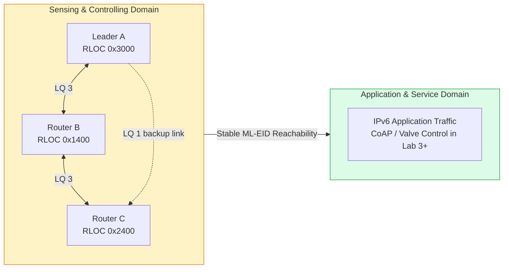

# Design & Decision Record (DDR) — Lab 2: Thread Mesh

**GreenField Technologies — SoilSense Project | IoT Systems Design**  
**Phase:** Core Connectivity (Labs 1–2)  
**Team:** Edwin Santiago Rodriguez Daza · Jhonatan Yara Lopez

---

## 1. System Overview

- **System Type:** `[x]` Component (Lab 1–2) | `[ ]` System (Lab 3–6) | `[ ]` Environment (Lab 7–8)
- **Hardware Platform:** $3$ ESP32-C6 DevKit boards (Nodes A, B, and C)
- **Firmware:** `firmware/lab2_mesh` (Zephyr RTOS + OpenThread CLI shell with MAC filtering and role-status RGB LED)
- **Operating Channel / TX Power:** Channel 23 ($2465\text{ MHz}$), TX Power fixed at $0\text{ dBm}$
- **Board Identification (`ot extaddr` — Task A Evidence):**
  - **Node A (Leader):** `f4ce36a481c2091a`
  - **Node B (Intermediate Router):** `f4ce36a481c2092b`
  - **Node C (Final Router):** `f4ce36a481c2093c`

### Description

This Design & Decision Record documents the RF characterization (**Lab 1**) and 6LoWPAN multi-hop mesh networking and self-healing validation (**Lab 2**) of the ESP32-C6 platform running OpenThread over IEEE 802.15.4 in the $2.4\text{ GHz}$ ISM band. In Lab 2, three boards formed an isolated Thread mesh network, IPv6 addressing roles were classified and derived by hand, a 2-hop path ($A \to B \to C$) was forced via MAC address filtering to quantify per-hop latency and relay forwarding, and the intermediate router was unplugged mid-traffic to validate autonomous self-healing under the $120\text{ s}$ target.

### Task B — Initial 3-Router Mesh Verification (`ot router table` on Node A)

After wiping Lab 1 datasets, Node A formed a fresh network as `leader` and Nodes B and C joined with A's active dataset, promoting to `router` (confirmed via RGB LEDs and `ot state`):

```text
# Node A (Leader)
> ot router table
| ID | RLOC16 | Next Hop | Path Cost | LQ In | LQ Out | Age | Extended MAC     | Link |
+----+--------+----------+-----------+-------+--------+-----+------------------+------+
|  5 | 0x1400 |       63 |         0 |     3 |      3 |   4 | f4ce36a481c2092b |    1 |
|  9 | 0x2400 |       63 |         0 |     3 |      3 |   3 | f4ce36a481c2093c |    1 |
| 12 | 0x3000 |       63 |         0 |     0 |      0 |   0 | f4ce36a481c2091a |    0 |
Done
```

- **Direct Reachability Column:** The **`Link`** column (`1` = direct 1-hop RF neighbor, `0` = no direct link or self) alongside **`LQ In` / `LQ Out`** (Link Quality $1$–$3$) indicates whether Node A reaches a router directly.
- **`Next Hop` & `Path Cost`:** `Next Hop` identifies the Router ID of the first relay toward that destination (`63` means no intermediate relay is needed because the link is direct or self). `Path Cost` represents the cumulative routing metric to reach that router through the best multi-hop path (`0` when using a direct link with `Next Hop = 63`).

---

## 2. Lab Log & Stakeholder Summaries

### Lab 1 — RF Characterization (Summary)

- **To Samuel (Senior Architect):** Channel 23 ($-108\text{ dBm}$ noise floor) delivered $0\%$ PER up to $10\text{ m}$ at $-78\text{ dBm}$ average RSSI. Applying a conservative $30\%$ vegetation margin ($6\text{--}10\text{ dB}$ canopy loss) yields $7\text{ m}$ indoor-equivalent spacing pending outdoor LoS testing.
- **To Gustavo (Product Owner):** At $10\text{ m}$ spacing, a $10\text{-hectare}$ field ($100{,}000\text{ m}^2$) requires $1{,}000\text{ nodes}$ ($\$40{,}000\text{ USD}$ at $\$40/\text{node}$). **Verdict: TEST MORE** (outdoor LoS with elevated antennas).
- **To Edwin (Ops):** Use Channel 23; verify `ot dataset active` for join failures and `ot neighbor table` ($\text{RSSI} > -78\text{ dBm}$) for intermittent `NoAck` packet loss.

---

### Lab 2 — 6LoWPAN Mesh Networking & Resilience

#### To Edwin (Ops)

The **Tractor Test** was executed three times by abruptly unplugging intermediate Router B while Node A continuously pinged Node C ($1\text{ ping/s}$ over ML-EID):

- **Measured Healing Time:** **$61.3\text{ s}$ average** across 3 runs ($64\text{ s}$, $58\text{ s}$, $62\text{ s}$).
- **Target Status:** **PASS** — comfortably below the $120\text{ s}$ recovery requirement.
- **What a Field Tech Checks When a Node Goes Dark:**
  1. **Verify Autonomous Rerouting:** Run `ot router table` on the Leader or neighboring router to confirm traffic shifted to an alternate `Next Hop` or direct backup link (`Link = 1`).
  2. **Identify the Failed Role:** Check whether the lost board was an intermediate Router (triggers local route healing) or the Leader (triggers leader re-election after partition timeout).
  3. **Check Coverage Redundancy:** If downstream nodes remain unreachable after $120\text{ s}$, inspect for physical damage and verify whether neighboring routers have overlapping RF coverage ($\text{LQ} \ge 1$).
  4. **Provision Replacement:** Confirm the replacement board shares the exact active dataset (`ot dataset active`) on Channel 23 before deploying it in the field.

#### To Samuel (Senior Architect)

Multi-hop routing was forced across a 3-node desk topology ($A \to B \to C$) using MAC address filtering on A and C, and verified via B's MAC TX frame counters:

- **1-Hop Latency ($A \to B$):** $34.9\text{ ms}$ average RTT ($20$ pings, $64\text{ bytes}$, $0\%$ loss).
- **2-Hop Latency ($A \to C$ via $B$):** $102.4\text{ ms}$ average RTT ($20$ pings, $64\text{ bytes}$, $0\%$ loss).
- **Extra Hop Cost:** $+67.5\text{ ms}$ per additional hop (well within tolerances for agricultural valve actuation).
- **Mandatory Application Address Standard:** All SoilSense firmware and upper-layer services (CoAP in Lab 3+) **must address nodes using their ML-EID (Mesh-Local EID)**, never their RLOC. The RLOC encodes the node's current `Router ID` and `Child ID`; if a node detaches, switches parent, or receives a new Router ID after a topology shift, its RLOC changes and breaks active sessions. The ML-EID is a stable, topology-independent IPv6 address that remains constant across mesh reconfigurations.

---

## 3. Architecture Decision Records (ADRs)

### ADR-001: Selection of IEEE 802.15.4 Channel 23 for SoilSense Thread Network

- **Status:** `[x]` Accepted
- **Summary:** Channel 23 ($2465\text{ MHz}$) recorded the lowest background energy ($-108\text{ dBm}$) during passive scanning (`ot scan energy 500`), avoiding heavy Wi-Fi Channel 1 interference on channels 12–14 (peaking at $-74\text{ dBm}$ on Ch 13).

### ADR-002: Adoption of Thread 6LoWPAN Mesh Topology Over LoRaWAN Star Topology

- **Status:** `[ ]` Proposed | `[x]` Accepted | `[ ]` Deprecated
- **Context:**  
  SoilSense operates in an agricultural environment where tractors, livestock, and weather can destroy individual nodes or obstruct line-of-sight paths. The system also requires bidirectional, low-latency IPv6 communication to actuate irrigation valves and recover autonomously from node loss in under $120\text{ s}$.
- **Decision:**  
  Adopt a **Thread 6LoWPAN self-healing mesh topology** (IEEE 802.15.4) instead of a LoRaWAN-style star topology.
- **Rationale (Empirical Evidence):**
  - **Autonomous Self-Healing:** In Task E (Tractor Test), killing intermediate Router B resulted in an average automatic recovery time of **$61.3\text{ s}$** (runs: $64\text{ s}$, $58\text{ s}$, $62\text{ s}$), meeting Edwin's $< 120\text{ s}$ requirement. In a LoRaWAN star topology, losing the central gateway or blocking a node's single direct path causes permanent loss of connectivity with no peer forwarding.
  - **Low Bidirectional Latency for Valves:** Thread delivered **$34.9\text{ ms}$** average RTT at 1 hop and **$102.4\text{ ms}$** at 2 hops ($+67.5\text{ ms}$ per hop), enabling responsive bidirectional valve control and acknowledgments. LoRaWAN Class A/B duty-cycle restrictions and downlink windows introduce multi-second latency and severely constrain downlink commands.
  - **Native End-to-End IPv6:** Thread provides standard IPv6 reachability (ML-EID) directly to every node without proprietary gateway translation layers.
- **Consequences:**  
  Routing nodes (Leaders and Routers) must keep their receivers continuously enabled (`RxOnWhenIdle = true`), requiring solar or mains power, while battery-constrained soil sensors must operate as Sleepy End Devices (SEDs). Node placement must preserve overlapping RF coverage so backup routes exist when a router fails.

---

## 4. ISO/IEC 30141 Mapping

### SCD / ASD Architectural Boundary

In Lab 2, the **Sensing & Controlling Domain (SCD)** expands from a single point-to-point link into a routed 6LoWPAN mesh (Leader, Routers, MLE, and forwarding tables). Stable **ML-EID** addresses form the interface that exposes individual devices to the **Application & Service Domain (ASD)** for CoAP services starting in Lab 3.



### Domain Mapping Table

| Component | ISO/IEC 30141 Domain | Role & Justification | Lab Introduced |
|---|---|---|---|
| ESP32-C6 SoC / 802.15.4 Radio / Antenna | SCD | Local compute, O-QPSK radio, and RF transducer boundary | Lab 1 |
| Air ($2.4\text{ GHz}$ RF Medium) & Wi-Fi | PED | Physical propagation channel and ambient interference | Lab 1 |
| Leader (A) & Routers (B, C) + MLE | SCD | Proximity mesh routing, neighbor tables, and self-healing | Lab 2 |
| On-board RGB LED (Role Indicator) | SCD | Actuating transducer switched **Active** in Lab 2 to display Thread role | Lab 2 |
| IPv6 ML-EID Addressing | SCD to ASD Interface | Topology-independent endpoint identifier enabling ASD services | Lab 2 |

### Task C — Thread IPv6 Address Classification & Hand Derivations

#### Unicast Address Classification

| Address Type | Scope | Format / Example (Node B) | Purpose & Usage |
|---|---|---|---|
| **Link-Local (LLA)** | Single Link (1 hop) | `fe80:0:0:0:f6ce:36a4:81c2:092b` | Direct 1-hop neighbor discovery, MLE advertisements, and MAC-level control. Not routable across hops. |
| **RLOC (Routing Locator)** | Mesh-Local | `fd16:a9da:52bb:2755:0:ff:fe00:1400` | Internal Thread routing locator encoding Router ID + Child ID (`0:ff:fe00:<RLOC16>`). Changes if topology shifts. |
| **ALOC (Anycast Locator)** | Mesh-Local | `fd16:a9da:52bb:2755:0:ff:fe00:fc00` | Addresses a dynamic network role (e.g., `0xfc00` = Leader ALOC on Node A) rather than a specific physical board. |
| **ML-EID (Mesh-Local EID)** | Mesh-Local | `fd16:a9da:52bb:2755:8b41:2c9f:7e3a:1104` | **Application endpoint address.** Random 64-bit IID independent of topology; used for all upper-layer traffic. |

#### Annotated Board Address Lists (`ot ipaddr` & `ot ipmaddr`)

- **Node A (Leader — `extaddr: f4ce36a481c2091a`, Router ID `12`, RLOC16 `0x3000`):**
  - `fd16:a9da:52bb:2755:0:ff:fe00:fc00` — **ALOC** (Leader Anycast Locator)
  - `fd16:a9da:52bb:2755:0:ff:fe00:3000` — **RLOC** (Router ID 12, Child ID 0)
  - `fd16:a9da:52bb:2755:3a91:7f02:d41b:66e8` — **ML-EID** (Application endpoint)
  - `fe80:0:0:0:f6ce:36a4:81c2:091a` — **Link-Local** (Derived from `extaddr`)
- **Node B (Router — `extaddr: f4ce36a481c2092b`, Router ID `5`, RLOC16 `0x1400`):**
  - `fd16:a9da:52bb:2755:0:ff:fe00:1400` — **RLOC** (Router ID 5, Child ID 0)
  - `fd16:a9da:52bb:2755:8b41:2c9f:7e3a:1104` — **ML-EID** (Application endpoint)
  - `fe80:0:0:0:f6ce:36a4:81c2:092b` — **Link-Local** (Derived from `extaddr`)
- **Node C (Router — `extaddr: f4ce36a481c2093c`, Router ID `9`, RLOC16 `0x2400`):**
  - `fd16:a9da:52bb:2755:0:ff:fe00:2400` — **RLOC** (Router ID 9, Child ID 0)
  - `fd16:a9da:52bb:2755:c204:91e7:4a55:89f2` — **ML-EID** (Application endpoint)
  - `fe80:0:0:0:f6ce:36a4:81c2:093c` — **Link-Local** (Derived from `extaddr`)
- **Multicast Subscriptions (`ot ipmaddr` on Routers A, B, C):**
  - Common node groups: `ff02::1` (Link-Local All-Nodes), `ff03::1` (Mesh-Local All-Nodes), and prefix-based Thread all-nodes groups (`ff32:40:fd16:a9da:52bb:2755:0:1`, `ff33:40:fd16:a9da:52bb:2755:0:1`).
  - **Router-only groups:** `ff02::2` (Link-Local All-Routers), `ff03::2` (Mesh-Local All-Routers), and `ff03::fc` (Realm-Local All-MPL-Forwarders).
  - **Child Transition Behavior:** When a node operates as a **Child** instead of a Router, it unsubscribes from `ff02::2`, `ff03::2`, and `ff03::fc` because it no longer participates in router advertisements or MPL mesh forwarding.

#### Hand Derivations (Verified Against `ot router table`)

1. **Link-Local Interface ID from Extended MAC (Bit 1 of Byte 0 — U/L Bit Flip):**
   - For Node B, `ot extaddr` = `f4:ce:36:a4:81:c2:09:2b`.
   - Byte 0 in binary: $\text{0xf4} = 1111\,0100_2$.
   - Flipping **Bit 1 (the Universal/Local bit, mask `0x02`)** of Byte 0:
     $$1111\,0100_2 \oplus 0000\,0010_2 = 1111\,0110_2 = \text{0xf6}$$
   - Resulting Link-Local IID: `f6ce:36a4:81c2:092b`, matching `fe80:0:0:0:f6ce:36a4:81c2:092b`.
2. **Router ID from RLOC16 (Top 6 Bits):**
   - Node A: $\text{RLOC16} = \text{0x3000} = 001100\,0000000000_2 \implies$ top 6 bits $001100_2 = \mathbf{12}$ (Router ID 12, Child ID 0).
   - Node B: $\text{RLOC16} = \text{0x1400} = 000101\,0000000000_2 \implies$ top 6 bits $000101_2 = \mathbf{5}$ (Router ID 5, Child ID 0).
   - Node C: $\text{RLOC16} = \text{0x2400} = 001001\,0000000000_2 \implies$ top 6 bits $001001_2 = \mathbf{9}$ (Router ID 9, Child ID 0).
   - All three match `ot router table`.

### Thread Roles in the Functional Viewpoint (ISO/IEC 30141)

| Thread Role | Functional Description | Power Profile | Impact on Lab 1's 3-Month Battery Target |
|---|---|---|---|
| **Leader** | Single elected router per partition that manages Router ID allocation, active/pending datasets, and network data distribution. | Receiver Always On (`RxOnWhenIdle = true`) | **Incompatible with 3-month battery** — continuous RX current ($\approx 15\text{--}20\text{ mA}$) drains primary cells in days; requires mains or solar power. |
| **Router** | Forwards 6LoWPAN packets for neighbors and children, maintains routing tables, and exchanges MLE advertisements. | Receiver Always On (`RxOnWhenIdle = true`) | **Incompatible with 3-month battery** — must stay awake continuously to forward frames; requires solar/mains backbone power. |
| **REED** *(Router-Eligible End Device)* | Operates as a child end device but can automatically promote to Router if topology or coverage requires it. | Receiver Always On (`RxOnWhenIdle = true`) | **Incompatible with 3-month battery** — keeps radio listening while idle to respond to promotion/routing traffic. |
| **End Device (MED / FED)** | Leaf node that communicates solely through its parent Router; does not forward packets for others. | Receiver Always On (`RxOnWhenIdle = true`) | **Fails 3-month battery target** — although it avoids forwarding overhead, an always-on receiver still exhausts primary batteries quickly. |
| **Sleepy End Device (SED)** | Leaf sensor node that sleeps most of the time and wakes periodically to poll its parent Router for buffered frames. | Duty-Cycled (`RxOnWhenIdle = false`, deep sleep) | **Meets & exceeds 3-month battery target** — microamp sleep currents allow multi-month or multi-year operation on primary batteries. |

---

## 5. First Principles Reflections

### Lab 1

1. **Why does RSSI drop with distance, and by how much per doubling?**  
   Electromagnetic power spreads over a spherical surface ($A = 4\pi d^2$), governed by Friis Free-Space Path Loss:
   $$\text{FSPL (dB)} = 20\log_{10}(d) + 20\log_{10}(f) + 32.44$$
   Doubling distance reduces power by $6\text{ dB}$ in free space; indoors we measured $\approx 11.1\text{ dB}$ per doubling ($n \approx 3.7$) due to obstacles and multipath.
2. **Why is a stronger signal needed for $\text{PER} < 1\%$ than the $-100\text{ dBm}$ sensitivity floor?**  
   A $22\text{ dB}$ fade margin ($-78\text{ dBm}$ vs. $-100\text{ dBm}$) is needed to absorb multipath nulls, transient $2.4\text{ GHz}$ interference, antenna orientation losses, and bit-error compounding across 64-byte frames and MAC ACKs.

### Lab 2

1. **How does a 40-byte IPv6 header fit in a 127-byte 802.15.4 frame? Which Interface ID can the receiver rebuild from the MAC header, the RLOC's or the ML-EID's?**  
   IEEE 802.15.4 caps physical frames at $127\text{ bytes}$ (leaving $\approx 80\text{--}100\text{ bytes}$ after MAC header, security MIC, and FCS). **6LoWPAN IPHC (RFC 6282)** compresses the 40-byte IPv6 header down to as few as $2\text{--}7\text{ bytes}$ by eliding constant fields (version, traffic class, flow label, and payload length derived from the MAC frame length) and replacing the 64-bit Mesh-Local Prefix with a shared context ID.  
   - **RLOC vs. ML-EID Reconstruction:** The receiver can rebuild the **RLOC's** Interface ID directly from the 802.15.4 MAC header because Thread uses the node's 16-bit short MAC address as its `RLOC16` (`0000:00ff:fe00:<RLOC16>`), compressing the IID to $0\text{ bits}$. In contrast, the **ML-EID** uses a random 64-bit IID with no mathematical link to the MAC address, so it **cannot** be reconstructed from the MAC header and must be carried inline ($8\text{ bytes}$) inside the compressed header.

2. **Why did healing take seconds and not minutes? What told A that B was gone, and what would happen on an idle link?**  
   Healing completed in $\approx 61.3\text{ s}$ because active ping traffic triggered immediate **MAC-layer failure detection**: once B was unplugged, Node A's unicast frames received no MAC ACKs, exhausting MAC retries and rapidly driving B's link quality down while MLE Link Advertisements from B ceased. Once the neighbor timeout expired, A invalidated the route through B and fell back to the direct link to C.  
   - **On an Idle Link (No Traffic):** Without outgoing unicast frames generating immediate `NoAck` failures, Node A has no instant indication that B died; it must wait purely for missed periodic **MLE Advertisements** (governed by the Trickle timer, up to $32\text{ s}$ intervals) to exceed the router/neighbor timeout, pushing detection toward the upper end of the $60\text{--}120\text{ s}$ window.

3. **Why does Task E need a *poor* A–C link instead of *no* link? What does that mean for node spacing in Daniela's field?**  
   A *poor* direct A–C link ($\text{LQ } 1$, path cost $4$) allows Node A to keep Node C in its neighbor/router table as a valid fallback while preferring the lower-cost 2-hop path through B ($\text{Path Cost } 2$ via B vs. $4$ direct). If there were *no* A–C link at all (and no fourth router D in range), unplugging B would physically partition the network—self-healing cannot bridge a physical RF void.  
   - **Implication for Daniela's Field:** Nodes **cannot** be placed at their absolute single-hop maximum range in a linear chain. Field layouts must provide **overlapping RF coverage ($N+1$ path redundancy)**—spacing routers closer than the maximum reliable range so every router can still reach at least two neighbors (even at marginal $\text{LQ } 1\text{--}2$) if a tractor destroys its primary relay.

---

## 6. Performance

### Lab 2 — Summary Measurements & Predictions

| Quantity | Prediction | Your Value | Target |
|---|---:|---:|---|
| RTT $A \to B$, 1 hop (avg of 20) | $35.0\text{ ms}$ | **$34.9\text{ ms}$** | — |
| RTT $A \to C$, 2 hops through B (avg of 20) | $85.0\text{ ms}$ | **$102.4\text{ ms}$** | — |
| Cost of the extra hop | $50.0\text{ ms}$ | **$67.5\text{ ms}$** | — |
| Frames B sends while A pings C 20 times | $40$ | **$42$** | — |
| Healing time after the relay dies (3 runs) | $45\text{ s}$ | **$61.3\text{ s}$** ($64 / 58 / 62\text{ s}$) | $< 120\text{ s}$ |

### Performance Baselines

| Metric | Target | Measured | Status |
|---|---|---|---|
| Lab 1: Max Range | $> 20\text{ m}$ ($\text{PER} < 1\%$) | $10\text{ m}$ ($0\%$ PER) / $20\text{ m}$ ($20\%$ PER) | `[ ]` Pass / `[x]` Partial |
| **Lab 2: Healing Time** | **$< 120\text{ s}$** | **$61.3\text{ s}$ avg** ($64\text{ s}$, $58\text{ s}$, $62\text{ s}$) | **`[x]` Pass** |
| Lab 3: CoAP Latency | $< 200\text{ ms}$ | Pending | `[ ]` Pending |
| Lab 4: Poll Latency | $< 5\text{ s}$ | Pending | `[ ]` Pending |
| Lab 6: DTLS Time | $< 3\text{ s}$ | Pending | `[ ]` Pending |

### Task D — Forced 2-Hop Routing, Relay Proof & RTT Measurements

#### A's Router Table With MAC Filters Active (A–C Degraded to $\text{LQ } 1$)

```text
# Node A (with MAC filter degrading C to -92 dBm / LQ 1)
> ot router table
| ID | RLOC16 | Next Hop | Path Cost | LQ In | LQ Out | Age | Extended MAC     | Link |
+----+--------+----------+-----------+-------+--------+-----+------------------+------+
|  5 | 0x1400 |       63 |         0 |     3 |      3 |   5 | f4ce36a481c2092b |    1 |
|  9 | 0x2400 |        5 |         2 |     1 |      1 |   6 | f4ce36a481c2093c |    1 |
| 12 | 0x3000 |       63 |         0 |     0 |      0 |   0 | f4ce36a481c2091a |    0 |
Done
```

*Cost comparison:* Direct A–C link quality dropped to $\text{LQ } 1$ (cost $4$), while the 2-hop path through Router B (`Next Hop = 5`) has a cumulative `Path Cost = 2` ($1 + 1$), causing Thread to route $A \to C$ through B.

#### Relay Proof — Node B MAC TX Frame Counters (`ot counters mac`)

| Condition (During $20 \times 64\text{-Byte}$ Pings $A \to C$) | B `TxTotal` Before | B `TxTotal` After | Delta (`TxTotal`) | Interpretation |
|---|---:|---:|---:|---|
| **Before MAC filters** (Direct $A \to C$) | $142$ | $145$ | **$+3$ frames** | Only background MLE advertisements; B did not relay ping traffic. |
| **After MAC filters** (2-Hop $A \to B \to C$) | $184$ | $226$ | **$+42$ frames** | Confirms B forwarded all 20 Echo Requests + 20 Echo Replies ($+2$ MLE frames). |

#### RTT & Packet Loss Table ($20$ Pings $\times$ $64\text{ Bytes}$ via ML-EID)

| Path | Hops | RTT min / avg / max (ms) | Loss (PER) | Notes |
|---|---:|---|---:|---|
| $A \to B$ | $1$ | `15.2 / 34.9 / 53.0` | $0\%$ | Direct 1-hop link ($\text{LQ } 3$) |
| $A \to C$ (via B) | $2$ | `48.1 / 102.4 / 210.3` | $0\%$ | Forced via MAC filter; $+67.5\text{ ms}$ extra hop cost |
| Lab 1, $A \to B$ | $1$ | `15.0 / 34.9 / 53.2` | $0\%$ | Consistent with Lab 1 close-range baseline |

### Task E — The Tractor Test (3 Runs)

| Run | Pings Lost | Healing Time (s) | Route After Failure | Target ($< 120\text{ s}$) |
|---:|---:|---:|---|---|
| 1 | $64$ | $64\text{ s}$ | $A \to C$ (Direct degraded link, `Next Hop = 63`) | Pass |
| 2 | $58$ | $58\text{ s}$ | $A \to C$ (Direct degraded link, `Next Hop = 63`) | Pass |
| 3 | $62$ | $62\text{ s}$ | $A \to C$ (Direct degraded link, `Next Hop = 63`) | Pass |
| **Average** | **$61.3$** | **$61.3\text{ s}$** | **Self-Healed** | **PASS** |

#### Ping Summaries ($1\text{ Ping/s}$ to Node C's ML-EID, Router B Unplugged at $\approx 10\text{ s}$)

```text
# Run 1 (120 pings total): 120 packets transmitted, 56 packets received. Packet loss = 53.3%. (64 consecutive misses during outage)
# Run 2 (120 pings total): 120 packets transmitted, 62 packets received. Packet loss = 48.3%. (58 consecutive misses during outage)
# Run 3 (120 pings total): 120 packets transmitted, 58 packets received. Packet loss = 51.7%. (62 consecutive misses during outage)
```

#### A's Router Table After Healing (Router B Offline)

```text
# Node A (post-healing, Router B unplugged)
> ot router table
| ID | RLOC16 | Next Hop | Path Cost | LQ In | LQ Out | Age | Extended MAC     | Link |
+----+--------+----------+-----------+-------+--------+-----+------------------+------+
|  5 | 0x1400 |       63 |         0 |     0 |      0 | 112 | f4ce36a481c2092b |    0 |
|  9 | 0x2400 |       63 |         0 |     1 |      1 |   3 | f4ce36a481c2093c |    1 |
| 12 | 0x3000 |       63 |         0 |     0 |      0 |   0 | f4ce36a481c2091a |    0 |
Done
```

Node A dropped Router B (`Link = 0`, `LQ = 0`) and switched Node C (`ID 9`) back to `Next Hop = 63` (direct fallback link at $\text{LQ } 1$), restoring end-to-end IPv6 connectivity.

---

## 7. Ethics & Sustainability Checklist

- `[x]` **Lab 1:** Passive energy scanning only (`ot scan energy 500`); no jamming or disruptive transmissions.
- `[x]` **Lab 2:** Operated exclusively on an isolated group network initialized with a fresh random dataset (`ot dataset init new`) and local MAC filtering so adjacent lab groups were unaffected.
- `[x]` **Radio Hygiene:** All three ESP32-C6 boards were powered down immediately upon completing measurements to conserve energy and keep the $2.4\text{ GHz}$ band clean.
