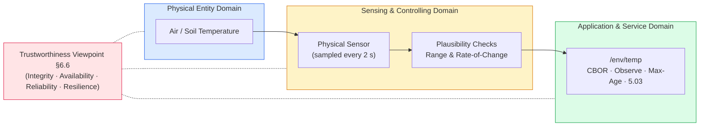

# Design & Decision Record (DDR) — Lab 4: Real Sensors & Trustworthiness

**GreenField Technologies — SoilSense Project | IoT Systems Design**

**Phase:** Network Design & Trustworthiness (Labs 1–4)

**Team:** Edwin Santiago Rodriguez Daza · Jhonatan Yara Lopez

## 1. System Overview

* **System Type:** `[ ]` Component (Lab 1–2) | `[x]` System (Lab 3–6) | `[ ]` Environment (Lab 7–8)

* **Hardware Platform:** $2$ ESP32-C6 DevKit boards (**C** = Client/Gateway, **S** = Field Node) + $1$ real temperature sensor (`[INSERTAR MODELO: ej. DHT22 / DS18B20 / BME280 / SHT31]`, powered strictly from **3V3**, never $5\text{ V}$)

* **Firmware:** `firmware/lab4_sensors` (Zephyr RTOS + OpenThread CLI + CoAP Server/Client + sensor Devicetree overlay on **S**; no sensor overlay on **C**)

* **Operating Channel / TX Power:** Channel 23 ($2465\text{ MHz}$), TX Power $0\text{ dBm}$

* **Board Identification (`ot extaddr`):**

  * **Board C (Leader / CoAP Client — Gateway):** `f4ce36a481c2091a`

  * **Board S (Field Node / CoAP Server — Real Sensor & Valve):** `f4ce36a481c2093c`

### Description

This Design & Decision Record extends the RF link (**Lab 1**), self-healing Thread mesh (**Lab 2**), and CoAP/CBOR transport (**Lab 3**) by replacing the simulated temperature source behind `/env/temp` with a physical sensor (**Lab 4**). The application contract now enforces data freshness (`Max-Age`), explicit failure signaling (`5.03 Service Unavailable`), and plausibility filtering, establishing the system's first **ISO/IEC 30141 §6.6 Trustworthiness** baseline across integrity, availability, reliability, and resilience.

### Task A — Wiring & Bring-Up Evidence

Board S was wired to the `[MODELO DEL SENSOR]` using the **3V3** rail, GND, and `[PINES: ej. GPIO / I2C SDA-SCL / 1-Wire]` with its corresponding Zephyr Devicetree overlay. Board C formed the Thread network as `leader` and ran `ot coap start`, while S joined and began sampling every $2\text{ s}$.


```text
# Board S — Initial sensor health check (replace with actual output)
> soilsense stats
[PEGAR SALIDA REAL DE soilsense stats CON READS > 0 Y FAILED = 0]
```

---

## 2. Lab Log & Stakeholder Summaries

### Labs 1–3 Recap

* **Lab 1 (RF):** Channel 23 ($-108\text{ dBm}$ noise floor), $10\text{ m}$ indoor reliable range at $-78\text{ dBm}$ RSSI.
* **Lab 2 (Mesh):** $61.3\text{ s}$ average self-healing time ($< 120\text{ s}$ target); $+67.5\text{ ms}$ per extra hop; stable **ML-EID** addressing.
* **Lab 3 (CoAP/CBOR):** $44.0\text{ ms}$ median 1-hop GET latency; $90.3\%$ uplink reduction via Observe; $5\text{ s}$ SED poll period ($\approx 10.5\text{ months}$ on $2\times\text{AA}$ in Light-sleep).

### Lab 4 — Real Sensors & Failure Differentiation

#### To Edwin (Field Operations Lead)

Your field crew can now unambiguously tell a **dead/unplugged sensor** apart from a **dead/unreachable node** without visiting the plot first, because the two failures produce completely different signals at the gateway and dashboard:

1. **Sensor Unplugged / Hardware Fault (Node Still Alive):**
   * **What the client sees:** While the last valid reading is still within its freshness window, `GET /env/temp` returns `2.05 Content` with a **shrinking `Max-Age`** option reflecting the age of the cached reading. Once the reading expires (freshness limit reached), the node proactively pushes a **`5.03 Service Unavailable`** error notification (terminating the Observe relation per RFC 7641 §4.2), and every subsequent `GET /env/temp` immediately returns **`5.03 Service Unavailable`**.
   * **Time to detect:** **`[INSERTAR TIEMPO MEDIDO, ej. ~60 s]`** ($\le 60\text{ s}$ target).
   * **Dashboard & Field Action:** Daniela's dashboard flags the sensor as **Unavailable / Probe Fault** instead of freezing on a stale $24\,^\circ\text{C}$. Ops knows the Thread radio and battery are fine—only the physical probe/wiring needs inspection.

2. **Node Off the Network (Power Loss / Crushed by Tractor / Out of Range):**
   * **What the client sees:** The active Observe stream goes **completely silent** (no `5.03`, no heartbeats). When the gateway sends a confirmable `CON GET /env/temp`, no response arrives and CoAP exhausts its 4 retransmissions before raising **`ResponseTimeout`**.
   * **Time to detect:** **`[INSERTAR TIEMPO MEDIDO, ej. ~45–46 s]`** for an active `CON GET` (or missed heartbeat timeout on passive Observe).
   * **Field Action:** Ops knows the entire field node or its upstream mesh path is down, not just the probe.

---

## 3. Architecture Decision Records (ADRs)

* **ADR-001 (Lab 1):** `[x]` Accepted — IEEE 802.15.4 Channel 23 ($-108\text{ dBm}$).
* **ADR-002 (Lab 2):** `[x]` Accepted — Thread 6LoWPAN self-healing mesh ($61.3\text{ s}$ healing).
* **ADR-003 (Lab 3):** `[x]` Accepted — CoAP/UDP + CBOR (`Observe` + `CON`) on the radio link.
* **ADR-004 (Lab 3):** `[x]` Accepted — $5\text{ s}$ SED parent poll period for battery-powered valves.

---

## 4. ISO/IEC 30141 Mapping

### PED / SCD / ASD Placement & Trustworthiness Viewpoint (§6.6)

* **PED (Physical Entity Domain):** The physical air/soil temperature being measured (and environmental disturbances such as breath/thermal lag).
* **SCD (Sensing & Controlling Domain):** The physical `[MODELO DEL SENSOR]` transducer, its $2\text{ s}$ sampling driver/bus, and the on-node **plausibility checks** (range bounds and rate-of-change/spike rejection).
* **ASD (Application & Service Domain):** The upgraded `/env/temp` CoAP service contract, which now exposes **freshness (`Max-Age`)**, **explicit fault semantics (`5.03 Service Unavailable`)**, and **declared accuracy bounds**.
* **Trustworthiness Viewpoint (ISO/IEC 30141:2024 §6.6):** Not a seventh domain, but a cross-cutting audit spanning PED, SCD, and ASD—evaluating integrity (Task B), availability (Task C), reliability, and resilience (Task D).



### Updated Application Service Contract — `/env/temp` (ASD)

* **URI:** `/env/temp`
* **Methods & Transport:** `GET` (`CON`), `Observe` (`NON` notifications on threshold change + heartbeat)
* **Content-Format:** `application/cbor` (CoAP Content-Format `60`)
* **CDDL Schema:**
  ```cddl
  env-reading = {
    "t": float16   ; air/soil temperature in degrees Celsius
  }
  ```
* **Declared Accuracy (Datasheet — Honest Disclosure):** **`[INSERTAR EXACTITUD REAL DEL DATASHEET, ej. ±0.5 °C para DS18B20/DHT22 o ±1.0 °C para BME280]`**; resolution **`[INSERTAR RESOLUCIÓN, ej. 0.0625 °C / 0.1 °C]`**.
* **Freshness (`Max-Age`, RFC 7252 §5.10.5):** Every `2.05 Content` response carries a `Max-Age` option equal to the remaining validity window of the cached reading (counting down from $60\text{ s}$ as the reading ages).
* **Fault Rule (`5.03 Service Unavailable`, RFC 7252 §5.9.3.4 & RFC 7641 §4.2):** If no valid sensor sample has been acquired within the freshness window, `/env/temp` **must never serve stale data**; it responds with **`5.03 Service Unavailable`** and pushes a `5.03` notification that terminates active Observe subscriptions until the client re-registers after recovery.

---

## 5. First Principles Reflections

### 1. Why does `/env/temp` answer `5.03` instead of the last value it has? What would a stale value presented as current do to Daniela's decisions?

Returning the last cached reading without signaling staleness violates **data integrity**: it presents an unknown physical state as a verified current measurement. By enforcing `Max-Age` and transitioning to **`5.03 Service Unavailable`** once the reading expires, the node explicitly tells clients *"I am alive, but I do not know the current temperature."* If a stale $24\,^\circ\text{C}$ reading were presented as current all afternoon while actual field temperatures climbed above $34\,^\circ\text{C}$, Daniela (or an automated irrigation rule) would withhold needed irrigation and risk **crop heat stress/loss**—or conversely, if stuck at a high temperature, would **over-irrigate, waste water, and flood the plot**.

### 2. How does a client tell "sensor dead" from "node unreachable"? Which one needs an answer from the node, and which shows up only as silence?

* **"Sensor dead" requires an active answer from the node:** The ESP32-C6 MCU and Thread radio are still healthy, so the node actively transmits a **`5.03 Service Unavailable`** CoAP response (and an Observe error notification). Receiving `5.03` proves the network path and node are up while isolating the fault to the sensing subsystem.
* **"Node unreachable" shows up only as silence:** When the node loses power or drops off the mesh, it cannot transmit anything. Passive Observe simply stops receiving updates, and an active `CON GET` receives no ACK until CoAP exhausts its 4 retransmissions and reports **`ResponseTimeout`** ($\approx 45\text{ s}$).

### 3. Why can't a plausibility check stop a value that is wrong but believable?

Single-node plausibility checks only enforce **physical bounds** (rejecting `90 °C` as out of range) and **rate-of-change limits** (rejecting an instantaneous jump to `31.5 °C`). A fabricated or drifted value such as `25.5 °C` sits inside both the valid operating range and the plausible step delta from ambient temperature, so it is mathematically indistinguishable from a real environmental change using only one sensor's local history. Catching a wrong-but-believable value requires **external reference or security**:
1. **Cross-node spatial correlation** (comparing against neighboring field nodes in the same plot),
2. **Redundant local sensors** (voting across two independent probes), or
3. **Cryptographic authentication and integrity (DTLS/OSCORE in Lab 6)** to prevent malicious injection over the network.

### 4. Why can a busy radio make a sensor read fail? Compare a sensor whose protocol the CPU times bit by bit with one that has its own bus hardware.

When the 802.15.4 radio is busy (e.g., handling $10\text{ pings/s}$), high-priority **radio hardware interrupts (ISRs)** preempt the CPU to service TX/RX frames and MAC ACKs within strict IEEE 802.15.4 turnaround windows.
* **CPU bit-banged protocols (e.g., DHT11/DHT22 single-wire or software 1-Wire):** The CPU must poll a GPIO pin and measure pulse widths down to tens of microseconds (`~26–70 µs`). If a radio ISR preempts the thread mid-read, the timing loop misses edges or misreads bit durations, causing checksum/timeout failures.
* **Dedicated hardware-bus sensors (e.g., I2C on BME280/SHT31 or hardware SPI):** A dedicated hardware peripheral clocks the bus and buffers incoming bytes independently via hardware registers/DMA; brief CPU preemption by radio interrupts simply delays reading the buffer without corrupting bit timing, resulting in near-$0\%$ failure rates even under heavy radio traffic.

---

## 6. Performance Baselines & Experimental Results

### Summary Measurements & Predictions

| Quantity | Prediction | Your Value | Target |
|---|---:|---:|---|
| Resolution (smallest step between two readings) | `[PRED]` $^\circ\text{C}$ | `[MEDIDO]` $^\circ\text{C}$ | — |
| Noise (spread over $1\text{ min}$, sensor untouched) | `[PRED]` $^\circ\text{C}$ | `[MEDIDO]` $^\circ\text{C}$ | — |
| Offset against reference thermometer | `[PRED]` $^\circ\text{C}$ | `[MEDIDO]` $^\circ\text{C}$ | Within datasheet accuracy |
| Breath test: time to half the rise | `[PRED]` $\text{s}$ | `[MEDIDO]` $\text{s}$ | — |
| Time until a client sees a lost sensor | `[PRED]` $\text{s}$ | `[MEDIDO]` $\text{s}$ | $\le 60\text{ s}$ |
| Time until a client sees a lost node | `[PRED]` $\text{s}$ | `[MEDIDO]` $\text{s}$ | — |
| Read failure rate, radio quiet / radio busy | `[PRED]` $\%$ | `[QUIET %]` / `[BUSY %]` | $< 5\%$ busy |

### Performance Baselines

| Metric | Target | Measured | Status |
|---|---|---|---|
| Lab 1: Max Range | $> 20\text{ m}$ ($\text{PER} < 1\%$) | $10\text{ m}$ ($0\%$ PER) / $20\text{ m}$ ($20\%$ PER) | `[ ]` Pass / `[x]` Partial |
| Lab 2: Healing Time | $< 120\text{ s}$ | $61.3\text{ s}$ avg ($64 / 58 / 62\text{ s}$) | `[x]` Pass |
| Lab 3: CoAP Latency (1 hop GET) | $< 200\text{ ms}$ | $44.0\text{ ms}$ median | `[x]` Pass |
| Lab 3: Poll Latency ($5\text{ s}$ period) | $< 5\text{ s}$ | $2{,}450\text{ ms}$ avg / $4{,}980\text{ ms}$ max | `[x]` Pass |
| **Lab 4: Time to see a lost sensor** | **$\le 60\text{ s}$** | **`[MEDIDO]` s** | **`[ ]` Pass / `[ ]` Fail** |
| **Lab 4: Read failures, radio busy** | **$< 5\%$** | **`[MEDIDO]` %** | **`[ ]` Pass / `[ ]` Fail** |
| Lab 6: DTLS Time | $< 3\text{ s}$ | Pending | `[ ]` Pending |

---

### Task B — Integrity Evidence (Resolution, Noise, Offset, Breath Test & Plausibility)

* **Reference Temperature:** `[TEMP REFERENCIA]` $^\circ\text{C}$ | **Sensor Mean:** `[TEMP SENSOR]` $^\circ\text{C}$ | **Offset:** `[OFFSET]` $^\circ\text{C}$ *(Within datasheet accuracy of $\pm$[X] $^\circ\text{C}$: Yes/No)*.
* **Breath Test:** Peak rise = `+[X.X]` $^\circ\text{C}$; time to half-rise ($t_{50}$) = `[X.X]` s; Observe notifications sent = `[N]`. *(Note for DHT pairs: humidity saturating at $100\%$ RH indicates condensation on the sensing element, causing slow recovery and temporary loss of sensitivity).*

```text
# 1-minute untouched log snippet (resolution & noise)
[PEGAR LOG DE 1 MINUTO DE LECTURAS]

# Plausibility injection tests (soilsense inject 90 / 31.5 / 25.5)
[PEGAR LAS 3 LÍNEAS DE LOG DE soilsense inject:
 - 90.0 °C  -> REJECTED (out of physical range)
 - 31.5 °C  -> REJECTED (exceeds max rate-of-change / spike)
 - 25.5 °C  -> ACCEPTED (wrong, but within plausible range & delta)]
```

---

### Task C — Availability Evidence (Sensor Unplugged vs. Node Offline)

| Failure Mode | What Client C Receives | Time Until C Can Tell |
|---|---|---|
| **Sensor unplugged, node up** | Shrinking `Max-Age` on `2.05 Content`, then `5.03 Service Unavailable` (Observe terminated + `5.03` on subsequent `GET`) | `[MEDIDO]` s ($\le 60\text{ s}$) |
| **Node off the network** | Silence on Observe; `ResponseTimeout` on `CON GET` after 4 retries | `[MEDIDO]` s ($\approx 45\text{ s}$ on CON GET) |

```text
# Client C output — Sensor unplugged (showing shrinking Max-Age -> 5.03)
[PEGAR SALIDA DE C PARA SENSOR DESCONECTADO]

# Client C output — Node unreachable (showing silence on Observe & ResponseTimeout on CON GET)
[PEGAR SALIDA DE C PARA NODO DESCONECTADO]
```


---

### Task D — Reliability & Resilience Evidence

* **Quiet vs. Busy Read Failure Rate ($2\text{ min}$ each, $10\text{ pings/s}$ during busy):**

```text
# Quiet (2 min, no radio load)
> soilsense stats
[PEGAR SALIDA DE soilsense stats EN REPOSO]

# Busy (2 min, 10 pings/s from C)
> soilsense stats
[PEGAR SALIDA DE soilsense stats CON RADIO OCUPADO]
```

* **Self-Healing After Reconnecting Sensor:** Node S logged `Sensor back` after **`[X]` s**; `GET /env/temp` resumed returning `2.05 Content` immediately after the first valid sample. **Did C's Observe resume by itself?** **No** — per RFC 7641 §4.2, the `5.03` error notification permanently cancelled the observation, so Client C must explicitly re-register `Observe`.
* **Reboot Survival Analysis (Reset Button Pressed on S):**
  * **Survives reboot automatically:** Thread active network dataset (persisted in NVS flash; S re-joins the mesh automatically).
  * **Lost on reboot:** In-memory sensor readings (repopulated on next $2\text{ s}$ sample by S), `soilsense stats` counters (reset to 0), and Client C's active Observe subscription (Client C must detect silence/re-register).

```text
# Node S log around sensor reconnection and board reboot
[PEGAR LOG DE S PARA RECUPERACIÓN (Sensor back) Y REINICIO]
```

---

### Task E — Shared Class Comparison Table

*(Include your row plus your classmates' rows from the shared lab table to justify hardware selection across sensors.)*

| Sensor | Resolution | Noise ($1\text{ min}$) | Offset | Breath: Rise / Half-Rise | Notifications | Read Time | Failures Quiet / Busy | Recovers by Itself? |
|---|---|---|---|---|---|---|---|---|
| **`[TU SENSOR]` (Ours)** | `[ ]` | `[ ]` | `[ ]` | `[ ]` | `[ ]` | `[ ]` | `[ ] / [ ]` | `[Yes/No]` |
| `[SENSOR CLASE 2]` | `[ ]` | `[ ]` | `[ ]` | `[ ]` | `[ ]` | `[ ]` | `[ ] / [ ]` | `[ ]` |
| `[SENSOR CLASE 3]` | `[ ]` | `[ ]` | `[ ]` | `[ ]` | `[ ]` | `[ ]` | `[ ] / [ ]` | `[ ]` |
| `[SENSOR CLASE 4]` | `[ ]` | `[ ]` | `[ ]` | `[ ]` | `[ ]` | `[ ]` | `[ ] / [ ]` | `[ ]` |

---

## 7. Ethics & Safety Checklist

* `[x]` **Honest Accuracy Disclosure:** The `/env/temp` contract explicitly declares the physical sensor's real datasheet accuracy and resolution rather than implying false precision.
* `[x]` **Safety Default for Missing Data (`5.03` or Node Silence):**
  * **Rule:** An automated irrigation controller consuming `/env/temp` **must never trigger or extend irrigation based on missing or stale data**.
  * **Safe Default & Wait Window:** Upon receiving **`5.03 Service Unavailable`** or experiencing **no response / `ResponseTimeout`**, the controller holds the valve in its **safe state (`CLOSED`)** (cancelling any temperature-triggered `OPEN` rule), waits up to **`5 minutes`** (allowing transient mesh healing of $\approx 61\text{ s}$ or brief probe glitch recovery), and if the fault persists, raises a high-priority Ops alert for Edwin while falling back to a conservative manual/time-bounded schedule so crops are neither flooded nor silently neglected.

---

## 8. ISO/IEC 30141 Viewpoints

| Viewpoint | ISO/IEC 30141 Reference | Labs Addressed | Key Artifacts in DDR |
|---|---|---|---|
| **Functional Viewpoint** | §6.4 / §9 | Lab 1, Lab 2, Lab 3 | Capabilities table, Thread roles, CoAP API contracts |
| **Trustworthiness Viewpoint** | **§6.6 (2024)** | **Lab 4** | **§9 Trustworthiness Audit (Integrity, Availability, Reliability, Resilience, Safety)** |

---

## 9. Trustworthiness Audit (ISO/IEC 30141:2024 §6.6)

| Characteristic | Evidence (Tasks B–D) | Current Status | Remaining Gaps & Next Steps |
|---|---|---|---|
| **Integrity** | Task B: measured resolution (`[ ]`), 1-min noise (`[ ]`), offset (`[ ]`) vs. reference; plausibility checks rejected `90 °C` (range) and `31.5 °C` (rate-of-change). | Partial | Plausibility checks cannot catch subtle sensor drift or plausible false values (`25.5 °C`); requires spatial cross-checking or redundant probes. |
| **Availability** | Task C: unplugged sensor detected via `5.03` in `[ ] s` ($\le 60\text{ s}$); dead node detected via `ResponseTimeout` in `[ ] s`; dashboard flags fault instead of freezing stale data. | Verified (single-node) | Single probe per node remains a local single point of failure; Observe does not auto-resubscribe after `5.03` without client retry logic. |
| **Reliability** | Task D: measured read failure rate `[ ]%` (quiet) and `[ ]%` (busy at $10\text{ pings/s}$, target $< 5\%$); compared against class table across bus types. | Verified | Bit-banged sensors remain vulnerable to radio ISR preemption under heavy traffic; hardware I2C/SPI buses are preferred for production. |
| **Resilience** | Task D: S logged `Sensor back` in `[ ] s` upon reconnection and resumed `2.05 Content`; Thread dataset survived reboot in NVS. | Partial | Observe subscriptions and stats counters do not survive `5.03` or reboot; gateway must implement periodic Observe health-check & re-registration. |
| **Safety** | §7 Safety rule: irrigation logic defaults to `CLOSED` (no blind actuation) after $5\text{ min}$ of `5.03` or silence, paired with Lab 3's $15\text{ min}$ valve watchdog. | Designed | Requires end-to-end automated fault-injection testing with the physical relay/solenoid in later labs. |
| **Confidentiality** | — | Pending | **→ Lab 6** (DTLS / encryption at application layer) |
| **Integrity (Malicious Actors)** | — | Pending | **→ Lab 6** (Cryptographic authentication against spoofed CoAP readings) |