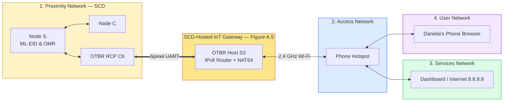

# Design & Decision Record (DDR) — Lab 5: Border Router

**GreenField Technologies — SoilSense Project | IoT Systems Design**

**Phase:** Integration (Labs 1–5)

**Team:** Edwin Santiago Rodriguez Daza · Jhonatan Yara Lopez

---

## 1. System Overview

* **System Type:** `[ ]` Component (Lab 1–2) | `[x]` System (Lab 3–6) | `[ ]` Environment (Lab 7–8)
* **Hardware Platform:**
  * **OTBR (OpenThread Border Router):** $1\times$ ESP32-S3-DevKitC-1 (PSRAM N8R8/N16R8, Wi-Fi host) wired via UART (`TX` $\leftrightarrow$ `RX` crossed + `GND`) to $1\times$ ESP32-C6 operating as an IEEE 802.15.4 **RCP (Radio Co-Processor)** over Spinel.
  * **Field Nodes:** Board **S** (ESP32-C6 with real temperature sensor & valve from Lab 4, rebuilt with SLAAC) and Board **C** (ESP32-C6 in-mesh CoAP client).
  * **Access Network:** $2.4\text{ GHz}$ WPA2 smartphone hotspot + laptop running `coap_client.py` / `dashboard_coap.py` + smartphone browser.
* **Firmware:**
  * RCP C6: `firmware/lab5_rcp`
  * OTBR S3: `firmware/lab5_border_router`
  * Nodes S & C: `firmware/lab4_sensors` (updated with SLAAC enabled)
* **Operating Channel:** IEEE 802.15.4 Channel `[INSERTAR CANAL ASIGNADO: 15 / 20 / 25 / 26]` (clear of Wi-Fi channels 1, 6, and 11)
* **Board Identification (`ot extaddr`):**
  * **OTBR (S3 + RCP C6):** `[PEGAR ot extaddr DEL OTBR]`
  * **Board C (In-mesh Client):** `f4ce36a481c2091a`
  * **Board S (Field Sensor & Valve):** `f4ce36a481c2093c`

### Description

This Design & Decision Record extends the SoilSense Thread mesh (**Labs 1–2**), CoAP/CBOR application layer (**Lab 3**), and real-sensor trustworthiness baseline (**Lab 4**) by introducing an **OpenThread Border Router (OTBR)** (**Lab 5**). Without modifying `/env/temp` or `/act/valve`, the OTBR bridges the IEEE 802.15.4 Thread mesh to Wi-Fi via IPv6 Off-Mesh Routable (OMR) prefixes and SLAAC, enables IPv6-only field nodes to reach the IPv4 Internet via NAT64, and preserves local in-mesh valve control when the gateway goes offline.

### Task A — Border Router Bring-Up Evidence (S3 $\leftrightarrow$ RCP C6)

```text
# On ESP32-S3 OTBR shell
> ot rcp version
[PEGAR SALIDA REAL DE ot rcp version]

> ot version
[PEGAR SALIDA REAL DE ot version]
```

### Task B — Wi-Fi, Thread Network & Border Routing Evidence

```text
# On ESP32-S3 OTBR shell
> wifi status
[PEGAR SALIDA REAL DE wifi status]

> ot state
[PEGAR SALIDA REAL DE ot state — ej. leader]

> ot br state
running
Done

> ot br omrprefix
[PEGAR SALIDA REAL DE ot br omrprefix — ej. Favored: fdxx:xxxx:xxxx:1::/64]

> ot netdata show
[PEGAR SALIDA REAL DE ot netdata show (Prefixes, Routes, Services)]
```

* **Advertised Prefix & Flags:** The OTBR advertises the Off-Mesh Routable (OMR) prefix `[PEGAR PREFIJO OMR, ej. fdxx:xxxx:xxxx:1::/64]` in `ot netdata show` with flags **`paos`** (`p` = preferred, `a` = SLAAC autoconfiguration, `o` = on-mesh, `s` = stable; plus `r` if default route is advertised on the prefix).
* **Global Prefix vs. ULA (`fd...`) and Why:** It is a **ULA (Unique Local Address, `fd00::/8`)** rather than a Global Unicast Address (`2000::/3`). Because the upstream smartphone hotspot does not delegate a public IPv6 prefix via DHCPv6-PD to the OTBR, the OTBR automatically generates a local ULA OMR prefix so Thread nodes can obtain routable IPv6 addresses reachable from the local Wi-Fi LAN while still reaching the IPv4 Internet through NAT64.

---

## 2. Lab Log & Stakeholder Summaries

### Labs 1–4 Recap

* **Lab 1 (RF):** Channel 23 ($-108\text{ dBm}$ noise floor), $10\text{ m}$ indoor reliable range at $-78\text{ dBm}$ RSSI.
* **Lab 2 (Mesh):** $61.3\text{ s}$ average self-healing time ($< 120\text{ s}$ target); $+67.5\text{ ms}$ per extra hop; stable **ML-EID** addressing.
* **Lab 3 (CoAP/CBOR):** $44.0\text{ ms}$ median 1-hop GET latency; $90.3\%$ uplink reduction via Observe; $5\text{ s}$ SED poll period ($\approx 10.5\text{ months}$ on $2\times\text{AA}$ in Light-sleep).
* **Lab 4 (Real Sensors):** Freshness (`Max-Age`), explicit probe-fault signaling (`5.03 Service Unavailable`), and first ISO/IEC 30141 §6.6 Trustworthiness audit.

### Lab 5 — Bridging the Mesh to Wi-Fi & the Internet

#### To Daniela (Pilot Farmer)

Your mesh is no longer an island—you can now monitor soil temperature and open or close the field valve directly from **your phone**:

* **Phone Reach & Latency (Task D):** Through the new OpenThread Border Router (OTBR) connected to the Wi-Fi hotspot, the dashboard loads on your phone and reaches the field node **S** directly over IPv6. Measured CoAP `GET /env/temp` round-trip time from the Wi-Fi network to S is **`[INSERTAR MEDIANA CoAP GET]` ms** (well below the $200\text{ ms}$ target), with the OTBR boundary adding only **`[INSERTAR LATENCIA AGREGADA OTBR]` ms** ($< 100\text{ ms}$ target) once Wi-Fi power-save is turned off. Valve `OPEN` / `CLOSE` commands from your phone execute immediately and confirm with `2.04 Changed`.
* **What Happens When the OTBR Dies (Task F):** We unplugged the OTBR mid-operation to verify field autonomy. Off-mesh access from the laptop and phone fails immediately (`[INSERTAR ERROR / TIEMPO DE FALLO DEL LAPTOP]`), because the Wi-Fi bridge is gone. **However, the field itself keeps working:** Board **C** inside the mesh still commanded **S**'s valve via its mesh-local address (`ML-EID`) with `2.04 Changed` and zero disruption. Anyone in the field retains full valve control even if the house gateway loses power.

---

## 3. Architecture Decision Records (ADRs)

* **ADR-001 (Lab 1):** `[x]` Accepted — Cleanest IEEE 802.15.4 channel selection.
* **ADR-002 (Lab 2):** `[x]` Accepted — Thread 6LoWPAN self-healing mesh ($61.3\text{ s}$ healing).
* **ADR-003 (Lab 3):** `[x]` Accepted — CoAP/UDP + CBOR (`Observe` + `CON`) on the radio link.
* **ADR-004 (Lab 3):** `[x]` Accepted — $5\text{ s}$ SED parent poll period for battery-powered valves.

### ADR-005: Single OpenThread Border Router (OTBR) for the SoilSense Pilot

* **Status:** `[ ]` Proposed | `[x]` Accepted | `[ ]` Deprecated
* **Context:** Daniela needs to monitor sensors and actuate valves from her phone over Wi-Fi/Internet, while Edwin requires the field mesh to remain operational if the gateway hardware fails. Deploying redundant Border Routers adds hardware cost, provisioning complexity, and extra mains-powered enclosures during the pilot phase.
* **Decision:** Deploy **one mains-powered OpenThread Border Router** (ESP32-S3 + ESP32-C6 RCP) with Wi-Fi power-save disabled (`wifi ps off`) to bridge the SoilSense Thread mesh to Wi-Fi and the Internet for the pilot.
* **Rationale (Tasks D–F Empirical Evidence):**
  * **Low Boundary Overhead (Task D):** With `wifi ps off`, the OTBR adds only **`[INSERTAR LATENCIA AGREGADA]` ms** (`(laptop -> S) - (laptop -> OTBR)`, target $< 100\text{ ms}$), keeping end-to-end CoAP `GET /env/temp` at **`[INSERTAR CoAP GET]` ms** ($< 200\text{ ms}$ target).
  * **Internet Reachability via NAT64 (Task E):** IPv6-only field nodes reach IPv4 Internet endpoints (`8.8.8.8`) through the OTBR's NAT64 translator in **`[INSERTAR NAT64 RTT]` ms** ($< 200\text{ ms}$ target).
  * **Bounded Failure Blast Radius (Task F):** Killing the OTBR only cuts off-mesh (Wi-Fi/phone) reachability; in-mesh Thread routing and local valve actuation (`C -> S` via `ML-EID`) continued working uninterrupted.
* **Consequences (Accepted Trade-Off):**
  * We explicitly accept a **single point of failure for off-mesh reachability only** (phone/cloud dashboard access goes down if the single OTBR loses power or fails), while preserving full in-field resilience. If commercial deployments require 24/7 remote telemetry SLA, a second OTBR can be added to the same Thread partition later without changing node firmware.

---

## 4. ISO/IEC 30141 Mapping

### Enterprise System Pattern — SCD-Hosted IoT Gateway (ISO/IEC 30141:2024 §A.4, Table A.3 & Figure A.5)

> *"IoT gateways are devices which connect SCD with other domains. IoT gateways provide functions such as protocol conversion, address mapping, data processing, information fusion, certification, and equipment management."* — **ISO/IEC 30141:2024, Table A.3**

* **Architectural Placement:** Per **Figure A.5**, the OTBR is tagged as an **SCD-hosted IoT gateway** sitting at the edge of the Sensing & Controlling Domain to bridge proximity networking to the access network. **RAID (Resource Access and Interchange Domain) is NOT claimed in Lab 5**—the OTBR forwards raw IPv6/UDP/CoAP packets without implementing access control, authentication, or API brokering (RAID activates in Labs 6–7).

#### Six-Function Scorecard (Table A.3 vs. Lab 5 Evidence)

| Table A.3 Gateway Function | Active in Lab 5? | Evidence / Justification |
|---|---|---|
| **1. Protocol conversion** | **Yes (L2/L3 framing)** | Bridges IEEE 802.15.4 / 6LoWPAN frames (via Spinel over UART to the C6 RCP) to IEEE 802.11 Wi-Fi / Ethernet frames. Does *not* convert L7 CoAP (CoAP bytes pass unchanged). |
| **2. Address mapping** | **Yes** | Translates IPv6-only Thread traffic to IPv4 Internet endpoints via **NAT64** (Task E: `S -> 8.8.8.8` via synthesized `fc00::/96` or `fd...::/96` prefix) and routes between Wi-Fi and Thread OMR prefixes. |
| **3. Data processing** | **No (Not yet)** | The OTBR acts as a transparent IPv6 router; it does not parse, filter, or transform CBOR payloads inside `/env/temp` or `/act/valve`. |
| **4. Information fusion** | **No (Not yet)** | Does not aggregate readings from multiple sensor nodes into composite field metrics. |
| **5. Certification** | **No (Not yet → Lab 6)** | No DTLS, certificates, or client authentication are enforced on the gateway or shell; anyone on the Wi-Fi hotspot can reach S. |
| **6. Equipment management** | **Partial / Minimal** | Manages local Thread network data advertisements (`ot netdata`, OMR/NAT64 prefixes) and RCP radio supervision over Spinel, but has no remote fleet/OTA device management yet. |

### Enterprise Networking Pattern — Four-Network Walk (ISO/IEC 30141:2024 §A.5, Table A.4 & Figure A.6)



| Network (Table A.4) | Role in SoilSense | Observed Addresses (From Tasks B–E) | What Crosses the Boundary |
|---|---|---|---|
| **Proximity Network** | IEEE 802.15.4 Thread mesh (Nodes S, C, and the OTBR's C6 RCP radio) | S ML-EID: `[PEGAR ML-EID DE S]`<br>S OMR: `[PEGAR OMR DE S]`<br>S RLOC: `[PEGAR RLOC DE S]` | Compressed 6LoWPAN IPv6/UDP/CoAP frames and Thread MLE control traffic. |
| **Access Network** | OTBR Wi-Fi interface and $2.4\text{ GHz}$ smartphone hotspot | OTBR Wi-Fi IPv4: `[PEGAR IPv4 DEL OTBR]`<br>OTBR Wi-Fi IPv6: `[PEGAR IPv6 LINK-LOCAL/ULA DEL OTBR]` | Standard IPv6 packets (for OMR prefix via RA/RIO) and NAT64-translated IPv4 packets. |
| **Services Network** | Laptop running `dashboard_coap.py` and external Internet (`8.8.8.8`) | Laptop IPv6/IPv4: `[PEGAR IP DEL LAPTOP]`<br>Public IPv4 test: `8.8.8.8` | End-to-end CoAP/CBOR UDP datagrams to S's OMR address; ICMPv4 echo via NAT64. |
| **User Network** | Daniela's smartphone accessing the dashboard UI | Phone IP: `[PEGAR IP DEL CELULAR / HOTSPOT]` | HTTP/WebSocket dashboard UI requests between browser and `dashboard_coap.py`. |

---

## 5. First Principles Reflections

### 1. Why does a prefix advertisement plus SLAAC make S reachable from outside, with no gateway "magic"?

Reachability across the OTBR relies purely on standard IPv6 routing and autoconfiguration—no proprietary proxy or application-layer gateway translation is needed:

1. **Inside the mesh (SLAAC, RFC 4862):** The OTBR advertises its OMR prefix (`fd...::/64` with the `a` SLAAC flag) inside Thread Network Data. Node S autonomously combines that prefix with an interface identifier to assign itself a globally/off-mesh routable IPv6 address (its OMR address).
2. **Outside the mesh (RIO, RFC 4191):** On the Wi-Fi interface, the OTBR broadcasts IPv6 **Router Advertisements (RAs)** containing a **Route Information Option (RIO)** announcing that the OTBR is the next hop for the OMR prefix. The laptop's OS kernel automatically installs that route in its IPv6 routing table.
3. **Result:** When the laptop sends a packet to S's OMR address, standard IPv6 forwarding delivers it to the OTBR over Wi-Fi, and the OTBR forwards the same IPv6 packet into the Thread mesh—pure L3 routing.

### 2. Why is NAT64 needed when Thread is IPv6?

Thread is strictly an **IPv6-only** network (6LoWPAN only compresses and carries IPv6 headers; there is no IPv4 stack on the ESP32-C6 field nodes). However, much of the public Internet and legacy cloud/DNS infrastructure—such as `8.8.8.8`—still operates on **IPv4**. **NAT64 (RFC 6052 / RFC 6146)** on the OTBR bridges this gap: the OTBR advertises a `/96` NAT64 prefix in Thread Network Data; Node S embeds the 32-bit IPv4 destination (`8.8.8.8`) into the last 32 bits of that IPv6 prefix (`<nat64-prefix>:0808:0808`), and the OTBR statelessly/statefully translates the IPv6 header into an IPv4 packet on its Wi-Fi interface (and translates replies back to IPv6).

### 3. Why are the bytes of `/env/temp` the same on both sides of the OTBR?

Because the OTBR operates as a **Network-layer (Layer 3) IP router**, not an Application-layer (Layer 7) HTTP/MQTT proxy. While the OTBR strips/rebuilds Layer 2 framing (IEEE 802.15.4 + 6LoWPAN compression on the Thread side vs. IEEE 802.11 Wi-Fi on the LAN side), the **UDP payload—the CoAP header, URI path `/env/temp`, and 6-byte CBOR payload—passes through completely untouched**. This end-to-end transparency is what allows Lab 6 to add end-to-end DTLS encryption directly between the client and Node S without the OTBR needing to decrypt traffic.

### 4. Why should a mains-powered gateway turn Wi-Fi power save off, when a battery node would do the opposite?

With Wi-Fi power save enabled (802.11 PSM), the ESP32-S3 puts its Wi-Fi radio to sleep between AP beacon intervals (typically every $100\text{ ms}$ or multiple DTIM intervals), buffering incoming packets at the hotspot and adding tens to hundreds of milliseconds of jitter and latency to every request crossing the gateway. A **battery-powered node** accepts that latency because radio sleep is mandatory to survive for months on AA cells. A **mains-powered OTBR**, however, has unlimited wall power and sits on the critical path for *every* node in the mesh: turning `wifi ps off` eliminates beacon-sleep latency spikes and keeps gateway overhead well below the $100\text{ ms}$ target at negligible energy cost.

---

## 6. Performance Baselines & Experimental Results

### Summary Measurements & Predictions

*(All RTTs are the average of 10 for `ping` or median of 10 for CoAP `GET`.)*

| Quantity | Prediction | Your Value | Target |
|---|---:|---:|---|
| In-mesh RTT, $C \to S$ (`ot ping`) | `[PRED]` ms | `[MEDIDO]` ms | $\approx 34.8\text{ ms}$ (Lab 3) |
| Wi-Fi hop, laptop $\to$ OTBR, power save **on** | `[PRED]` ms | `[MEDIDO]` ms | — |
| Wi-Fi hop, laptop $\to$ OTBR, power save **off** | `[PRED]` ms | `[MEDIDO]` ms | — |
| Laptop $\to$ S, `ping` (OMR address) | `[PRED]` ms | `[MEDIDO]` ms | — |
| Laptop $\to$ S, CoAP `GET /env/temp` | `[PRED]` ms | `[MEDIDO]` ms | $< 200\text{ ms}$ |
| **OTBR added latency:** $(\text{laptop} \to S) - (\text{laptop} \to \text{OTBR})$ | `[PRED]` ms | **`[MEDIDO]` ms** | **$< 100\text{ ms}$** |
| **NAT64:** $S \to 8.8.8.8$ | `[PRED]` ms | **`[MEDIDO]` ms** | **$< 200\text{ ms}$** |
| OTBR off: $C \to S$ `PUT /act/valve` (via ML-EID) | Works | `[Works / Fails]` | Works |

### Performance Baselines

| Metric | Target | Measured | Status |
|---|---|---|---|
| Lab 1: Max Range | $> 20\text{ m}$ ($\text{PER} < 1\%$) | $10\text{ m}$ ($0\%$ PER) / $20\text{ m}$ ($20\%$ PER) | `[ ]` Pass / `[x]` Partial |
| Lab 2: Healing Time | $< 120\text{ s}$ | $61.3\text{ s}$ avg ($64 / 58 / 62\text{ s}$) | `[x]` Pass |
| Lab 3: CoAP Latency (1 hop GET) | $< 200\text{ ms}$ | $44.0\text{ ms}$ median | `[x]` Pass |
| Lab 3: Poll Latency ($5\text{ s}$ period) | $< 5\text{ s}$ | $2{,}450\text{ ms}$ avg / $4{,}980\text{ ms}$ max | `[x]` Pass |
| Lab 4: Time to see a lost sensor | $\le 60\text{ s}$ | `[LAB 4 MEDIDO]` s | `[ ]` Pass |
| Lab 4: Read failures, radio busy | $< 5\%$ | `[LAB 4 MEDIDO]` % | `[ ]` Pass |
| **Lab 5: OTBR added latency** | **$< 100\text{ ms}$** | **`[MEDIDO]` ms** | **`[ ]` Pass / `[ ]` Fail** |
| **Lab 5: NAT64 RTT ($S \to 8.8.8.8$)** | **$< 200\text{ ms}$** | **`[MEDIDO]` ms** | **`[ ]` Pass / `[ ]` Fail** |
| Lab 6: DTLS Time | $< 3\text{ s}$ | Pending | `[ ]` Pending |

---

### Task C — S and C Joined to OTBR Mesh & Annotated Addresses

```text
# On OTBR shell
> ot router table
[PEGAR SALIDA REAL DE ot router table DEL OTBR]

> ot child table
[PEGAR SALIDA REAL DE ot child table DEL OTBR]

# On Node S — Annotated ot ipaddr
> ot ipaddr
[PEGAR DIRECCIÓN OMR]          <- OMR (Off-Mesh Routable, SLAAC from OTBR's advertised OMR prefix)
[PEGAR DIRECCIÓN RLOC]         <- RLOC (Mesh-Local Routing Locator, 0:ff:fe00:<RLOC16>)
[PEGAR DIRECCIÓN ML-EID]       <- Mesh-Local EID (stable in-mesh application address)
[PEGAR DIRECCIÓN LINK-LOCAL]   <- Link-Local (fe80::, single-hop neighbor discovery/MLE)
```

* **New Address Explanation:** Compared to Lab 4, Node S gained one additional IPv6 address—its **OMR address** (`fd...`). The **OTBR** told S the prefix by publishing it in Thread Network Data with the SLAAC flag (`a`), allowing S to auto-configure it locally.

---

### Task D — Off-Mesh Reachability, Power-Save Comparison & Phone Dashboard

* **Laptop Route to OMR Prefix:** Installed automatically by the laptop's IPv6 stack upon receiving the OTBR's **Router Advertisement (RA)** with a **Route Information Option (RIO, RFC 4191)** over Wi-Fi.

```text
# Laptop routing table entry for the OMR prefix (ip -6 route / route print)
[PEGAR RUTA IPv6 HACIA EL PREFIJO OMR EN EL LAPTOP]

# 4 RTT Summaries
- Wi-Fi hop (laptop -> OTBR, wifi ps on):  [PEGAR AVG RTT] ms
- Wi-Fi hop (laptop -> OTBR, wifi ps off): [PEGAR AVG RTT] ms
- Laptop -> S OMR (ping, 10 packets):      [PEGAR AVG RTT] ms
- Laptop -> S OMR (coap_client.py --count 10): [PEGAR MEDIAN RTT] ms

# Node S log line for valve PUT triggered from Daniela's phone
[PEGAR LÍNEA DE LOG DE S CUANDO SE ABRIÓ/CERRÓ LA VÁLVULA DESDE EL CELULAR]
```


---

### Task E — NAT64 Evidence (`S -> 8.8.8.8`)

```text
# On Node S
> ot ping 8.8.8.8
[PEGAR SALIDA REAL DE ot ping 8.8.8.8 MOSTRANDO LA IPv6 SINTETIZADA Y EL RTT]

# NAT64 prefix/route line from ot netdata show
[PEGAR LÍNEA DE RUTA NAT64 DE ot netdata show — ej. fdxx:xxxx:xxxx:2:0:0::/96 s med ...]
```

---

### Task F — Killing & Restoring the Border Router

* **With S3 Unplugged:**
  * **In-mesh (`C -> S` `PUT /act/valve` to S's ML-EID):** **Succeeded** (`2.04 Changed` immediately; S toggled the valve LED).
  * **Off-mesh (Laptop `GET /env/temp` to S's OMR):** **Failed** after `[INSERTAR TIEMPO]` with `[INSERTAR ERROR DEL CLIENTE EN EL LAPTOP — ej. Timeout / No route to host]`.
* **After Plugging S3 Back In:** Did S3 rejoin as `leader`? **`[Sí / No — explicar: mientras S3 estuvo apagado, C o S promovió a Leader de la partición local; al volver S3, se une como Router o fusiona particiones según Partition Weight/ID]`**.

```text
# Board C response to PUT /act/valve while OTBR was unplugged
[PEGAR RESPUESTA DE C]

# Laptop error when retrying GET while OTBR was unplugged
[PEGAR ERROR DEL LAPTOP]

# Node S log confirming local valve command succeeded during OTBR outage
[PEGAR LOG DE S]
```

---

## 7. Ethics, Sustainability, Security & Privacy Checklist

* `[x]` **Sustainability & Local Autonomy (Task F Evidence):** Unplugging the mains-powered OTBR did not disable field operations—local in-mesh actuation (`C -> S` over ML-EID) remained functional, preventing crop loss or stranded valves during gateway power outages.
* `[x]` **Security Gap Flagged — Unauthenticated Physical Shell:** Anyone physically holding the OTBR's USB cable has full root-level access to the OpenThread CLI (`ot dataset active`, `ot br`, `wifi`) with zero authentication; production enclosures require tamper-resistant housings and disabling/locking the debug shell.
* `[x]` **Privacy & Access-Control Gap Flagged — Open Hotspot Exposure (→ Lab 6):** Because the OTBR bridges the Thread OMR prefix directly onto the Wi-Fi hotspot without transport-layer authentication or encryption, **any device connected to the same Wi-Fi hotspot can currently read `/env/temp` and command `/act/valve`**. Locking down these bytes with end-to-end DTLS/authentication is deferred to **Lab 6**.

---

## 8. ISO/IEC 30141 Viewpoints

| Viewpoint / Pattern | ISO/IEC 30141:2024 Reference | Labs Addressed | Key Artifacts in DDR |
|---|---|---|---|
| **Functional Viewpoint** | §6.4 / §9 | Lab 1, Lab 2, Lab 3 | Capabilities table, Thread roles, CoAP API contracts |
| **Trustworthiness Viewpoint** | §6.6 | Lab 4, Lab 5 | §9 Trustworthiness Audit (Integrity, Availability, Reliability, Resilience, Safety, Security/Privacy gaps) |
| **Enterprise System Pattern** | **§A.4 (Table A.3 / Figure A.5)** | **Lab 5** | **OTBR placed as SCD-hosted IoT gateway + 6-function Table A.3 scorecard (RAID deferred to Labs 6–7)** |
| **Enterprise Networking Pattern** | **§A.5 (Table A.4 / Figure A.6)** | **Lab 5** | **Four-network walk (Proximity, Access, Services, User) mapped to SoilSense addresses** |

---

## 9. Trustworthiness Audit Update (ISO/IEC 30141:2024 §6.6)

| Characteristic | Lab 5 Addition / Evidence | Status | Remaining Gaps |
|---|---|---|---|
| **Availability / Resilience** | Task F proved local in-mesh valve control survives OTBR power loss; single OTBR accepted as SPOF for off-mesh reach only (ADR-005). | Verified (local) | Off-mesh dashboard/phone access has no gateway redundancy in the pilot. |
| **Security & Privacy** | Exposed new attack surfaces: unauthenticated OTBR USB shell and unencrypted CoAP reachable from any host on the Wi-Fi hotspot. | Gap Identified | **→ Lab 6** (DTLS end-to-end encryption & authentication; RAID activation). |
