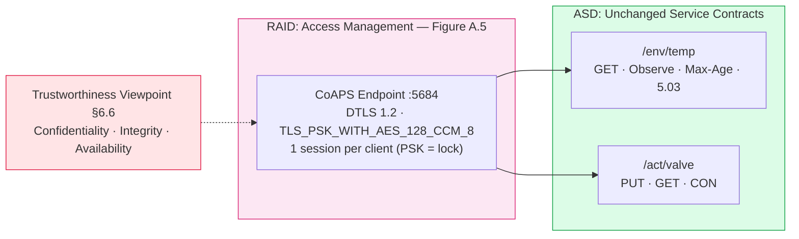

# Design & Decision Record (DDR) — Lab 6: CoAP over DTLS & Trustworthiness

**GreenField Technologies — SoilSense Project | IoT Systems Design**  
**Phase:** Hardening (Labs 1–6)  
**Team:** Edwin Santiago Rodriguez Daza · Jhonatan Yara Lopez

---

## 1. System Overview

- **System Type:** `[ ]` Component (Lab 1–2) | `[x]` System (Lab 3–6) | `[ ]` Environment (Lab 7–8)
- **Hardware Platform:** Lab 5 topology — OTBR ($1 \times$ ESP32-S3-DevKitC-1 + $1 \times$ ESP32-C6 RCP), Board **S** (ESP32-C6 with real temperature sensor & valve), Board **C** (ESP32-C6 in-mesh CoAPS client), laptop and smartphone on the $2.4\text{ GHz}$ WPA2 hotspot.
- **Firmware:**
  - Board **S** & Board **C**: `firmware/lab6_secure` (Lab 4 sensor/valve firmware with the CoAP server moved to **DTLS 1.2 over UDP port `5684`** and a `coaps` CLI client; sensor Devicetree overlay applied to **S** only).
  - OTBR: `firmware/lab5_border_router` (S3) + `firmware/lab5_rcp` (C6).
- **Security Profile:** CoAPS (`coaps://`), DTLS 1.2 (RFC 6347), cipher suite `TLS_PSK_WITH_AES_128_CCM_8` (RFC 6655 / RFC 4279 / RFC 7925), UDP port `5684`.
- **Unchanged Application Contracts:** `/env/temp` and `/act/valve` (exact same URIs, methods, CBOR schemas, `Max-Age`, and `5.03` semantics from Labs 3–4; only the transport security layer changed).

### Task A — Threat Model (STRIDE, Completed Before Task B)

**Date:** `[INSERTAR FECHA ANTES DE EJECUTAR TASK B]`  
**Threat Actor:** Unauthenticated attacker on the farmhouse guest Wi-Fi (Access Network) with a generic CoAP client, able to reach **S**'s OMR IPv6 address through the Lab 5 OTBR (Edward's memo).

| STRIDE Category | Concrete Threat Against SoilSense | Impact | Expected Control (Tested in Tasks B–F) |
|---|---|---|---|
| **Information Disclosure** | Attacker on the farmhouse Wi-Fi sends plain `GET /env/temp` or sniffs Wi-Fi packets to read Daniela's soil temperature telemetry (`a1 61 74 ...`). | Loss of farm operational privacy; exposure of irrigation schedules and microclimate data. | Disable plain CoAP (`UDP 5683`); enforce **CoAPS (DTLS 1.2 `AES_128_CCM_8` on `UDP 5684`)** so payloads are encrypted end-to-end on the wire (Tasks B & D). |
| **Tampering** | Attacker on the Wi-Fi sends a forged `PUT /act/valve` (`{"state": true}`) or modifies an in-flight packet to open the irrigation valve. | Physical safety & crop damage (drowning Daniela's seedlings and wasting water). | **DTLS PSK mutual authentication + AEAD CCM-8 integrity tag**: unauthenticated/wrong-key handshakes and tampered records are silently dropped before reaching `/act/valve` (Task B). |
| **Denial of Service (DoS)** | Attacker floods **S**'s UDP `5684` port with concurrent DTLS handshakes or holds open all available DTLS session slots on the memory-constrained ESP32-C6. | Legitimate clients (Daniela's dashboard or Edwin's Ops shell) are locked out of sensor readings and valve control. | DTLS HelloVerifyRequest cookie exchange (stateless anti-spoofing) + session idle timeouts; **residual gap tested in Task F** (finite concurrent session limit on S requires rate-limiting/monitoring in Lab 7). |

---

## 2. Lab Log & Stakeholder Summaries

### Labs 1–5 Recap

- **Lab 1 (RF):** Channel 23 ($-108\text{ dBm}$ noise floor), $10\text{ m}$ indoor reliable range at $-78\text{ dBm}$ RSSI.
- **Lab 2 (Mesh):** $61.3\text{ s}$ average self-healing time ($< 120\text{ s}$); $+67.5\text{ ms}$ per extra hop; stable **ML-EID** addressing.
- **Lab 3 (CoAP/CBOR):** $44.0\text{ ms}$ median 1-hop GET; $90.3\%$ uplink reduction via Observe; $5\text{ s}$ SED poll period.
- **Lab 4 (Real Sensors):** `Max-Age` freshness, `5.03 Service Unavailable` probe-fault reporting, first Trustworthiness §6.6 audit.
- **Lab 5 (Border Router):** OTBR (S3 + C6 RCP) bridged Thread to Wi-Fi via OMR/SLAAC and NAT64 while preserving local in-mesh valve control when the OTBR is unplugged.

### Lab 6 — Hardening CoAP with DTLS (CoAPS)

#### To Edward (Security Lead)

The stop-ship vulnerability exposed in Lab 5 is closed for the pilot:

- **Can the Guest Wi-Fi Attacker Still Read `/env/temp` or Forge `OPEN`? (Task B):** **No.** Plain CoAP (`UDP 5683`) from both the laptop and in-mesh Board **C** is now refused (`[INSERTAR COMPORTAMIENTO: ej. ICMP Port Unreachable / timeout]`). Attempting CoAPS (`UDP 5684`) with a **wrong PSK** fails during the DTLS handshake with silence/timeout—no temperature reading is returned and a forged `PUT /act/valve` (`{"state": true}`) never reaches the actuator. Only clients presenting the valid lab PSK (Board **C** and the authorized laptop/dashboard) complete the handshake and receive `2.05 Content` / `2.04 Changed`.
- **What the Lock Costs (Tasks C–D):**
  - **Handshake Latency:** `[INSERTAR TIEMPO C->S]` ms inside the mesh and **`[INSERTAR TIEMPO LAPTOP->S]` ms** from the laptop through the OTBR (target $< 3\text{ s}$).
  - **Amortized Per-Reading Latency:** Once the DTLS session is established, a `GET /env/temp` takes **`[INSERTAR MEDIANA CoAPS GET]` ms**, closely matching Lab 5's plain CoAP latency (`[INSERTAR LAB 5 GET]` ms).
  - **Wire & Energy Cost:** Each DTLS `AES_128_CCM_8` record adds **$29\text{ bytes}$** ($13\text{ B}$ DTLS header + $8\text{ B}$ explicit nonce + $8\text{ B}$ AEAD tag), keeping readings inside a single $127\text{ B}$ 802.15.4 frame. Keeping sessions open across at least **`[INSERTAR N LECTURAS DE TASK C]` readings** keeps handshake energy below $10\%$ of total radio cost.
- **Residual Risks Tracked:** The lab PSK is currently hardcoded in firmware (must move to per-device provisioning/secure storage before production), and **S** only supports **`[INSERTAR MAX SESIONES DE TASK F]`** concurrent DTLS sessions, leaving session-exhaustion DoS and attack alerting to be monitored in Lab 7.

---

## 3. Architecture Decision Records (ADRs)

- **ADR-001 (Lab 1):** `[x]` Accepted — Cleanest IEEE 802.15.4 channel selection.
- **ADR-002 (Lab 2):** `[x]` Accepted — Thread 6LoWPAN self-healing mesh ($61.3\text{ s}$ healing).
- **ADR-003 (Lab 3):** `[x]` Accepted — CoAP/UDP + CBOR (`Observe` + `CON`) on the radio link.
- **ADR-004 (Lab 3):** `[x]` Accepted — $5\text{ s}$ SED parent poll period for battery-powered valves.
- **ADR-005 (Lab 5):** `[x]` Accepted — Single mains-powered OTBR for pilot off-mesh reachability.

### ADR-006: DTLS 1.2 with Pre-Shared Key (PSK) for the Pilot Over X.509 Certificates

- **Status:** `[ ]` Proposed | `[x]` Accepted | `[ ]` Deprecated
- **Context:** After Lab 5 bridged the Thread mesh to Wi-Fi, `/env/temp` and `/act/valve` became exposed to any host on the access network. SoilSense requires end-to-end authentication, integrity, and confidentiality over UDP (`CoAPS`) without breaking the $127\text{ B}$ 802.15.4 frame budget, $< 3\text{ s}$ handshake target, or 3-month battery budget.
- **Decision:** Use **DTLS 1.2 with Pre-Shared Key (`TLS_PSK_WITH_AES_128_CCM_8`)** on UDP port `5684` for the pilot phase, keeping sessions persistent across readings, instead of X.509 certificate-based DTLS (`ECDHE_ECDSA`).
- **Rationale (Task C Empirical Evidence):**
  - **Fast, Lightweight Handshake:** PSK avoids asymmetric public-key operations (ECDSA signature verification and multi-kilobyte X.509 certificate chains that fragment into dozens of 6LoWPAN frames). In Task C, the PSK handshake completed in **`[INSERTAR TIEMPO C->S]` ms** in-mesh and **`[INSERTAR TIEMPO LAPTOP->S]` ms** through the OTBR ($< 3\text{ s}$ target), with per-request latency over an open session at **`[INSERTAR CoAPS GET]` ms**.
  - **Low Battery & Byte Overhead:** Only $29\text{ B}$ are added per CoAP record, and by reusing a session for $\ge$ `[N]` readings, handshake energy stays under $10\%$ of total radio consumption.
- **Consequences (What Shared PSK Gives Up & Fleet Trigger for Certificates):**
  - **Lost Per-Device Identity & Individual Revocation:** With a shared fleet PSK, **S** cannot distinguish which specific client or node holds the key, and if a single field board is stolen and its flash is dumped, the **entire fleet must be re-keyed**—a single compromised node cannot be revoked individually.
  - **Fleet Size Trigger for Certificates / Per-Device Keys:** Beyond a small single-farm pilot (**$\ge 20\text{--}50$ nodes** or **multi-customer commercial deployment**), operational re-keying risk becomes unacceptable. At that scale, SoilSense must migrate to **unique per-device X.509 certificates (ECDSA P-256)** or unique per-device PSKs backed by a PKI/commissioning service so individual nodes can be audited and revoked without touching the rest of the farm.

---

## 4. ISO/IEC 30141 Mapping

### RAID Access Management & Cross-Cutting Trustworthiness (§6.6)

In Lab 6, the **Resource Access and Interchange Domain (RAID)** activates for the first time via its **access-management** component (ISO/IEC 30141:2024 Figure A.5): the **CoAPS DTLS endpoint (`UDP 5684`, `TLS_PSK_WITH_AES_128_CCM_8`, one session per client)** acts as the security gate deciding who may invoke the ASD capabilities. The **ASD contracts (`/env/temp` and `/act/valve`) remain completely unchanged**. RAID's other half—the interchange subsystem—will be added in Lab 7.



### Domain Placement Summary

| Component | ISO/IEC 30141 Domain | Role & Status in Lab 6 |
|---|---|---|
| **CoAPS Endpoint (`UDP 5684`, `TLS_PSK_WITH_AES_128_CCM_8`, 1 session/client)** | **RAID (Access Management)** | **New in Lab 6.** Authenticates clients via PSK and protects CoAP records end-to-end before dispatching to ASD resources. |
| **`/env/temp` & `/act/valve` (CBOR / CDDL)** | **ASD** | **Unchanged from Labs 3–4.** Business logic and data contracts are decoupled from transport security. |
| **Thread Mesh / OTBR / Physical Sensor** | **SCD** | **Unchanged from Labs 1–5.** Provides hop-by-hop 802.15.4 link security, routing, and sensing. |

### Why Does SoilSense Need *Both* Thread Link-Layer Encryption (Lab 2) and DTLS (Lab 6)?

1. **Thread Link-Layer Encryption (AES-CCM over 802.15.4)** is **hop-by-hop** inside the proximity mesh using a single shared mesh network key. It stops outside RF eavesdroppers from sniffing 802.15.4 frames, **but it terminates at the OTBR**. Once the OTBR forwards an IPv6 packet onto Wi-Fi (or receives a packet from the guest Wi-Fi in Edward's memo), Thread link encryption offers zero protection across the access network—and any compromised router inside the mesh can still read or forge traffic between other nodes.
2. **DTLS (CoAPS)** is **end-to-end** per session from the client (laptop/dashboard or Board C) all the way to the CoAP server on Board S. It protects readings and valve commands across Wi-Fi, the OTBR, and intermediate Thread routers alike, ensuring that neither a guest Wi-Fi attacker nor a compromised intermediate relay can read or forge `/act/valve`.

---

## 5. First Principles Reflections

### 1. Why DTLS and not TLS for CoAP?

Standard **TLS** requires a reliable, in-order byte stream (**TCP**): if a packet is lost or arrives out of order, TLS breaks the stream cipher/MAC sequence state and tears down the connection. Because CoAP runs over connectionless, unreliable **UDP** (to fit 127-byte frames and sleepy nodes), **DTLS (RFC 6347)** adapts TLS for datagrams by adding:
- Explicit **epoch** and **48-bit sequence numbers** in every record header so lost or reordered UDP packets do not corrupt decryption state,
- Handshake message **retransmission timers** and fragmentation support, and
- A stateless **`HelloVerifyRequest` cookie** exchange to prevent UDP source-IP spoofing amplification attacks.

### 2. Why does one AEAD tag give both confidentiality and integrity?

`AES_128_CCM_8` is an **Authenticated Encryption with Associated Data (AEAD)** mode combining two primitives derived from the same session key and unique nonce:
- **CTR mode (AES-CTR)** XORs the plaintext CoAP message with a pseudorandom keystream to provide **confidentiality** (turning `a1 61 74 ...` into indistinguishable ciphertext).
- **CBC-MAC** computes an 8-byte authentication tag (ICV) over both the plaintext and the unencrypted **Additional Authenticated Data (AAD)** (epoch, sequence number, record type, version, length).

Because the tag depends cryptographically on every plaintext bit, every AAD header field, and the secret session key, flipping even a single bit of ciphertext or replaying a record causes tag verification to fail and the record to be discarded—delivering confidentiality, integrity, and replay protection in one single pass.

### 3. Why is authentication, not encryption, what stops the forged `OPEN`?

Encryption alone only hides the contents of a message from passive eavesdroppers; it does **not** prove *who* sent a command. Even if `/act/valve` traffic were encrypted with an unauthenticated cipher, an attacker who knows the public API contract (`{"state": true}`) could still initiate a connection and send a valid `OPEN` command—or replay/malleate a captured ciphertext. What actually stops Edward's forged `OPEN` is **cryptographic authentication** (proving possession of the shared PSK during the DTLS handshake and validating the per-record AEAD MAC tag), which guarantees that only an authorized party holding the key can establish a session and produce an accepted `PUT /act/valve`.

### 4. Why does a wrong key produce silence instead of an error message?

In DTLS (RFC 6347 §4.1.2.7), when a server receives a handshake `Finished` message or record that fails decryption/MAC verification due to a wrong key, silently discarding the invalid packet (rather than returning a verbose plaintext alert explaining *"wrong PSK"* or *"bad padding"*) prevents:
1. **Oracle & enumeration attacks:** Attackers cannot distinguish a wrong key from a closed port or use timing/error codes to probe key material.
2. **UDP amplification / DoS:** Because UDP source addresses can be spoofed, replying with error packets to every invalid datagram would waste the constrained ESP32-C6's battery and turn field nodes into reflection amplifiers.

---

## 6. Performance Baselines & Experimental Results

### Summary Measurements & Predictions

| Quantity | Prediction | Your Value | Target |
|---|---:|---:|---|
| Plain CoAP GET from the laptop to S | Refused | Works? `[No]` | Refused |
| CoAPS GET with the wrong key | Refused | Works? `[No]` | Refused |
| DTLS handshake, C → S inside the mesh | `[PRED]` ms | `[MEDIDO]` ms | — |
| DTLS handshake, laptop → S through the OTBR | `[PRED]` ms | `[MEDIDO]` ms | $< 3\text{ s}$ |
| GET over an open session, laptop → S | `[PRED]` ms | `[MEDIDO]` ms | $\approx$ Lab 5 value |
| Bytes a DTLS record adds to one CoAP message | $29\text{ B}$ | `[MEDIDO]` B | — |
| Clients S serves at the same time | `[PRED]` | `[MEDIDO]` | — |

### Performance Baselines

| Metric | Target | Measured | Status |
|---|---|---|---|
| Lab 1: Max Range | $> 20\text{ m}$ ($\text{PER} < 1\%$) | $10\text{ m}$ ($0\%$ PER) / $20\text{ m}$ ($20\%$ PER) | `[ ]` Pass / `[x]` Partial |
| Lab 2: Healing Time | $< 120\text{ s}$ | $61.3\text{ s}$ avg ($64 / 58 / 62\text{ s}$) | `[x]` Pass |
| Lab 3: CoAP Latency (1 hop GET) | $< 200\text{ ms}$ | $44.0\text{ ms}$ median | `[x]` Pass |
| Lab 3: Poll Latency ($5\text{ s}$ period) | $< 5\text{ s}$ | $2{,}450\text{ ms}$ avg / $4{,}980\text{ ms}$ max | `[x]` Pass |
| Lab 4: Time to see a lost sensor | $\le 60\text{ s}$ | `[LAB 4]` s | `[ ]` Pass |
| Lab 4: Read failures, radio busy | $< 5\%$ | `[LAB 4]` % | `[ ]` Pass |
| Lab 5: OTBR added latency | $< 100\text{ ms}$ | `[LAB 5]` ms | `[ ]` Pass |
| Lab 5: NAT64 RTT | $< 200\text{ ms}$ | `[LAB 5]` ms | `[ ]` Pass |
| **Lab 6: DTLS Time (laptop → S handshake)** | **$< 3\text{ s}$** | **`[MEDIDO]` ms** | **`[ ]` Pass / `[ ]` Fail** |
| **Lab 6: DTLS Per-Record Overhead** | — | **`[MEDIDO]` B** (theoretical: $29\text{ B}$) | **Recorded** |

---

### Task B — Access Control Verification (5 Attempts + S's Log)

| # | Source & Mode | Target | Result | Failure / Response Observed |
|---:|---|---|---|---|
| 1 | Laptop — Plain CoAP (`UDP 5683`) | `GET /env/temp` | **Refused** | `[PEGAR ERROR: ej. timeout / port unreachable]` |
| 2 | Board C — Plain CoAP (`UDP 5683`) | `GET /env/temp` | **Refused** | `[PEGAR ERROR EN SHELL DE C]` |
| 3 | Board C — CoAPS (`UDP 5684`, lab PSK) | `GET /env/temp` | **Served (`2.05`)** | `[PEGAR TEMPERATURA RECIBIDA]` |
| 4 | Laptop — CoAPS (`UDP 5684`, lab PSK) | `GET /env/temp` & `PUT /act/valve` | **Served (`2.05` / `2.04`)** | `[PEGAR RESPUESTA VALIDA]` |
| 5 | Laptop — CoAPS (`UDP 5684`, **wrong PSK**) | `GET /env/temp` & forged `PUT /act/valve` | **Refused** | **Silence / Handshake timeout** (forged `OPEN` blocked) |

```text
# 1. Laptop plain CoAP (refused)
[PEGAR SALIDA 1]

# 2. Board C plain CoAP (refused)
[PEGAR SALIDA 2]

# 3. Board C CoAPS with lab PSK (served)
[PEGAR SALIDA 3]

# 4. Laptop CoAPS with lab PSK (served)
[PEGAR SALIDA 4]

# 5. Laptop CoAPS with WRONG PSK — including forged PUT /act/valve (refused)
[PEGAR SALIDA 5]

# Board S log for the served requests (and confirmation wrong-key PUT was never executed)
[PEGAR LOG DE S]
```

---

### Task C — Handshake Cost, Flight Analysis & Session Energy Policy

#### Handshake Timing & Flight Count (`-v` Verbose Log)
- **In-mesh handshake (C → S):** `[MEDIDO]` ms
- **Off-mesh handshake (Laptop → OTBR → S):** `[MEDIDO]` ms ($< 3\text{ s}$ target)
- **Flight count:** **`[CONTAR FLIGHTS, tipicamente 6 flights en DTLS 1.2 PSK con HelloVerifyRequest]`** (`ClientHello` → `HelloVerifyRequest` → `ClientHello + cookie` → `ServerHello + ServerHelloDone` → `ClientKeyExchange + ChangeCipherSpec + Finished` → `ChangeCipherSpec + Finished`). Most of the latency goes into the **3 full round trips across Wi-Fi + OTBR + 802.15.4** plus session key derivation (PRF/AES-CCM setup) on the ESP32-C6.

```text
# Verbose DTLS flight log (-v) from laptop
[PEGAR LOG -v DE LOS FLIGHTS DEL HANDSHAKE]
```

#### Open-Session RTT vs. Lab 5 Plain CoAP (10 GETs)
- **Lab 5 Plain CoAP GET (median of 10):** `[LAB 5]` ms
- **Lab 6 CoAPS GET over open session (median of 10):** `[MEDIDO]` ms
- **Delta:** `+ [DIFERENCIA]` ms (AES-128-CCM hardware acceleration on ESP32-C6 makes per-packet encryption latency negligible once the session is open).

#### Energy Arithmetic & Session Policy
- **ESP32-C6 Datasheet Reference:** IEEE 802.15.4 Active RX current $I_{\text{RX}} = 73\text{ mA}$ (*ESP32-C6-WROOM-1 Datasheet* Table 16 / *ESP32-C6 Series Datasheet* Table 5-9).
- **One CoAPS Reading Cost:** Radio active window $t_{\text{read}} \approx$ `[ej. 10 ms o 0.01 s]` $\implies Q_{\text{read}} = 73\text{ mA} \times t_{\text{read}}$.
- **One DTLS Handshake Cost:** Extra radio-on time across handshake flights $t_{\text{hs}} \approx$ `[INSERTAR TIEMPO ACTIVO DEL HANDSHAKE, ej. 6 flights * 10 ms = 60 ms o tiempo medido]` $\implies Q_{\text{hs}} = 73\text{ mA} \times t_{\text{hs}}$.
- **10% Amortization Rule (Session Policy):** For the handshake energy to remain $< 10\%$ of total session energy:
  $$\frac{Q_{\text{hs}}}{N \cdot Q_{\text{read}}} < 0.10 \implies N > 10 \cdot \frac{t_{\text{hs}}}{t_{\text{read}}} = \mathbf{[CALCULAR\;N]}$$
- **Session Policy:** Clients must keep a single DTLS session open for at least **`[N]` readings** (e.g., persistent Observe/dashboard session) rather than opening a fresh DTLS handshake per `GET`.

---

### Task D — Wire Capture & DTLS Record Byte Breakdown

- **Plaintext Check:** Searching the Wireshark capture of the CoAPS `GET /env/temp` response for the CBOR bytes `a1 61 74` (`{"t": ...}`) returns **0 matches**—the payload is completely encrypted ciphertext inside a DTLS `Application Data` record (`Content Type = 23`).


#### Exact Per-Record Byte Overhead (`DTLS 1.2` + `TLS_PSK_WITH_AES_128_CCM_8`, RFC 6347 / RFC 6655)

| DTLS Record Field | Size (Bytes) | Purpose |
|---|---:|---|
| Content Type (`23` = Application Data) | $1\text{ B}$ | Identifies record type (Handshake, Alert, App Data) |
| Protocol Version (`0xfe 0xfd` = DTLS 1.2) | $2\text{ B}$ | DTLS version identifier |
| Epoch | $2\text{ B}$ | Increments on `ChangeCipherSpec` to track active cipher state |
| Sequence Number | $6\text{ B}$ | Explicit per-record sequence number for UDP ordering & anti-replay |
| Fragment Length | $2\text{ B}$ | Length of the encrypted payload + nonce + tag |
| **Subtotal — DTLS Record Header** | **$13\text{ B}$** | **Unencrypted AAD authenticated by CCM-8** |
| Explicit Nonce (RFC 6655) | $8\text{ B}$ | Per-record unique nonce combined with 4-byte implicit salt |
| AEAD Authentication Tag (`CCM_8` ICV) | $8\text{ B}$ | 64-bit CBC-MAC integrity/authenticity tag |
| **Total Overhead Added per CoAP Message** | **$29\text{ B}$** | Verified against capture: `UDP payload len - CoAP msg len = [MEDIDO] B` |

Adding $29\text{ B}$ DTLS overhead to a $15\text{ B}$ CoAP `/env/temp` response ($44\text{ B}$ UDP payload) plus $\approx 52\text{ B}$ UDP/6LoWPAN/MAC still fits inside a **single $127\text{ B}$ IEEE 802.15.4 frame** ($\approx 96\text{ B} < 127\text{ B}$).

---

### Task E — Daniela's Dashboard Over DTLS

Running `tools/dashboard_coap.py` with DTLS/PSK enabled restored full browser visibility and valve actuation from Daniela's phone over encrypted CoAPS (`UDP 5684`):

```text
# Board S log line for the authenticated valve PUT coming from the phone dashboard
[PEGAR LOG DE S DEL PUT DESDE EL DASHBOARD OVER DTLS]
```


---

### Task F (Optional) — Concurrent Client Session Limit

- **Maximum concurrent DTLS clients served by S:** **`[INSERTAR CONTEO]`**
- **Failing client output:** `[PEGAR SALIDA DEL CLIENTE QUE FALLA AL SUPERAR EL LIMITE]`
- **DoS Implication (Edward's STRIDE Row):** Because **S** has limited RAM for mbedTLS session contexts, an attacker on the Wi-Fi who opens `[N]` idle sessions (or floods handshakes) can block Daniela's dashboard unless idle sessions are evicted rapidly and anomalous connection rates are detected (Lab 7).

---

## 7. Ethics, Privacy, Safety & Transparency Checklist

- `[x]` **Privacy:** All in-transit sensor telemetry (`/env/temp` readings) and actuation commands (`/act/valve` states) are now encrypted end-to-end with `AES_128_CCM_8` across both the Wi-Fi access network and the Thread mesh (verified via Task D wire capture: `a1 61 74` absent).
- `[x]` **Safety:** Demonstrated experimentally in Task B that a forged `PUT /act/valve` (`OPEN`) sent over plain CoAP or with a wrong PSK is refused and never actuates the valve (evidence recorded in Task B logs, not merely claimed), complementing Lab 3's $15\text{ min}$ open-valve watchdog and Lab 4's `CLOSED` default on `5.03`/silence.
- `[x]` **Transparency (Hardcoded Key Disclosure & Production Plan):** In this lab build (`firmware/lab6_secure`), the shared PSK is **hardcoded directly in the firmware source/binary**, which is insecure for production because anyone who extracts the flash image compromises every node. In production, unique per-device keys/certificates must be generated at provisioning time and stored in **hardware-protected non-volatile storage** (e.g., ESP32-C6 **eFuse key blocks** with Flash Encryption enabled, or an external hardware Secure Element such as ATECC608B), never committed to source control.

---

## 8. ISO/IEC 30141 Viewpoints

| Viewpoint / Pattern | ISO/IEC 30141 Reference | Labs Addressed | Key Artifacts in DDR |
|---|---|---|---|
| **Functional Viewpoint** | §6.4 / §9 | Labs 1, 2, 3, 6 | Capabilities table, Thread roles, CoAP API contracts (ASD), CoAPS endpoint (RAID Access Management) |
| **Trustworthiness Viewpoint** | **§6.6 (2024)** | **Labs 4, 6** | **§9 Full 7-Row Trustworthiness Audit + Task A STRIDE Threat Model** |
| **Enterprise System Pattern** | §A.4 (Table A.3, Fig. A.5) | Labs 5, 6 | OTBR as SCD-hosted IoT gateway; CoAPS endpoint as RAID Access Management |
| **Enterprise Networking Pattern** | §A.5 (Table A.4, Fig. A.6) | Lab 5 | Four-network walk (Proximity, Access, Services, User) |

---

## 9. Trustworthiness Audit (ISO/IEC 30141:2024 §6.6 — Complete 7-Row Matrix)

| Characteristic | Evidence (Labs 4 & 6) | Current Status | Remaining Gaps & Next Steps |
|---|---|---|---|
| **1. Confidentiality** | **Lab 6 (Tasks B & D):** Plain CoAP (`5683`) disabled; `TLS_PSK_WITH_AES_128_CCM_8` encrypts `/env/temp` and `/act/valve` end-to-end across Wi-Fi and Thread; Wireshark capture confirms `a1 61 74` is unreadable ciphertext. | **Addressed (Pilot)** | Shared PSK is hardcoded in firmware (must move to per-device eFuse/Secure Element keys in production). |
| **2. Integrity (Data & Malicious Actors)** | **Lab 4 (Task B):** Plausibility checks rejected out-of-range (`90 °C`) and spike (`31.5 °C`) readings. **Lab 6 (Task B):** DTLS PSK authentication + 8-byte AEAD CCM-8 tag reject forged `PUT /act/valve` and wrong-key clients. | **Addressed (In-Transit)** | **Firmware integrity gap:** does not yet verify signed firmware/OTA updates against physical or remote tampering (**→ Lab 8**). Subtle physical sensor drift still requires cross-node checks. |
| **3. Availability** | **Lab 4 (Task C):** Unplugged sensor detected via `5.03` ($\le 60\text{ s}$); dead node via `ResponseTimeout`. **Lab 5 (Task F):** In-mesh valve control survives OTBR loss. **Lab 6 (Task E):** Dashboard works over DTLS. | **Partial** | Finite concurrent DTLS session slots on S expose session-exhaustion DoS (Task F); **noticing an attack or a dead node across a 200-node fleet** requires automated health telemetry & alerting (**→ Lab 7**). |
| **4. Reliability** | **Lab 4 (Task D):** Quiet vs. busy ($10\text{ pings/s}$) read failure rates measured ($< 5\%$ target) and compared across class bus types. **Lab 6 (Task C):** Open-session CoAPS GETs maintain low latency matching Lab 5. | **Verified** | Bit-banged sensors remain sensitive to radio ISR preemption; long-lived DTLS session recovery after link hiccups needs automated client retry logic. |
| **5. Resilience** | **Lab 2 (Task E):** Mesh self-heals in $61.3\text{ s}$. **Lab 4 (Task D):** Sensor logs `Sensor back` upon reconnection; Thread dataset survives reboot in NVS. | **Partial** | DTLS sessions and Observe subscriptions do not survive a node reboot; clients must detect silence/re-handshake and re-register automatically. |
| **6. Safety** | **Lab 3 (§7):** $15\text{ min}$ hardware watchdog closes valve if `CLOSE` is lost. **Lab 4 (§7):** Irrigation defaults to `CLOSED` after $5\text{ min}$ of `5.03`/silence. **Lab 6 (Task B):** Forged `OPEN` refused on wire. | **Addressed (Design & Transport)** | Requires end-to-end validation with physical solenoid hardware and signed firmware enforcement (**→ Lab 8**). |
| **7. Privacy** | **Lab 6 (Tasks B, D & E):** Farm environmental data (`/env/temp`) and operational patterns (`/act/valve`) are hidden from guest Wi-Fi sniffers via end-to-end DTLS encryption. | **Addressed (In-Transit)** | Metadata (IPv6 OMR addresses, packet timing, and sizes) remains visible on the Wi-Fi LAN; dashboard/cloud data-at-rest access control and audit logging remain for **Lab 7**. |