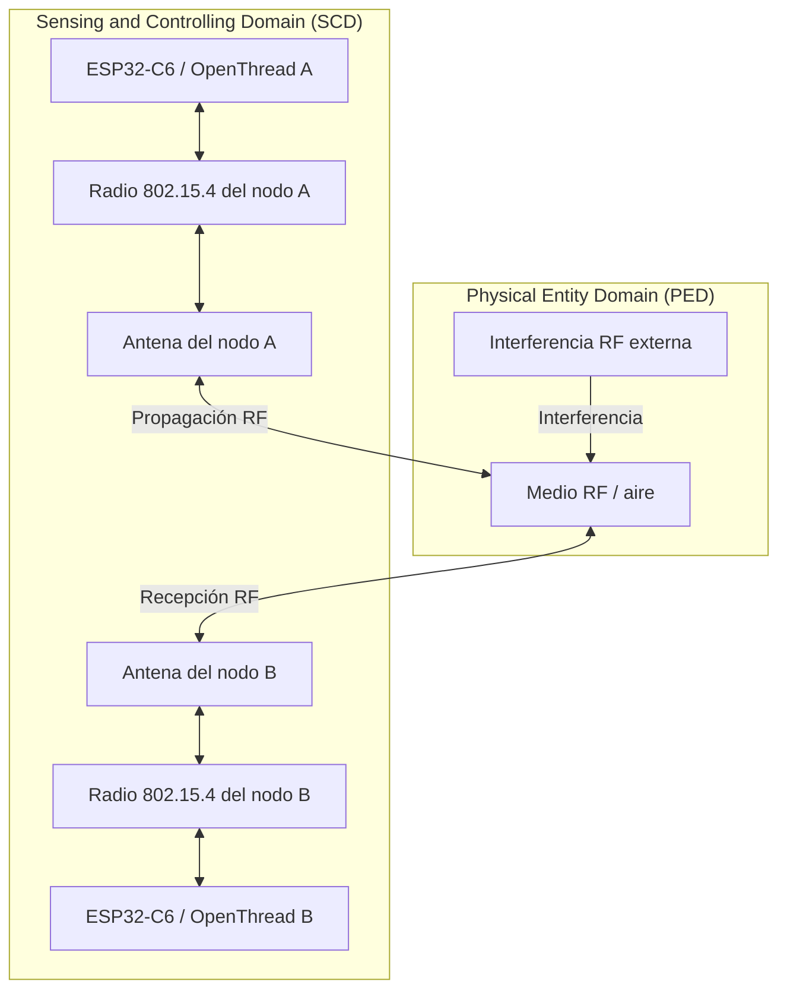

# Lab 1 — Testing Your Wireless Radio

**Proyecto:** GreenField Technologies — SoilSense  
**Fase:** Feasibility Study  
**Asignatura / laboratorio:** Sistemas IoT — Zephyr + ESP32-C6 + IEEE 802.15.4 / OpenThread  
**Equipo de referencia:** ESP32-C6-DevKitC-1  
**Fecha:** 22 de octubre de 2026

> **Nota sobre la validez de los datos:** las tablas de este documento conservan los valores proporcionados en el borrador original. Deben considerarse resultados experimentales únicamente si fueron obtenidos durante las pruebas reales y respaldados por registros de consola. Si son valores ilustrativos, reemplázalos por las mediciones propias antes de entregar el informe.

---

## 1. Descripción del dispositivo y del objetivo

Este informe documenta la evaluación del enlace de radio IEEE 802.15.4 de un nodo ESP32-C6 para el proyecto SoilSense. Se busca responder tres preguntas:

1. ¿Cuál es la separación máxima entre nodos que mantiene una entrega fiable de paquetes?
2. ¿Qué canal de 2,4 GHz presenta el menor nivel de energía detectada?
3. ¿Qué valor de RSSI se asocia con una entrega de paquetes de al menos el 99 %?

La prueba utiliza dos placas ESP32-C6-DevKitC-1 con OpenThread sobre Zephyr. La comunicación se valida mediante ping IPv6 y la intensidad de señal se consulta con `ot neighbor table`.

### 1.1 Parámetros de prueba

| Parámetro | Valor |
|---|---|
| Tecnología de radio | IEEE 802.15.4 a 2,4 GHz |
| Pila de red | OpenThread sobre Zephyr |
| Potencia TX de referencia | 0 dBm |
| Canales del escaneo | 11–26 |
| Tiempo de escaneo por canal | 500 ms |
| Tráfico de prueba | 100 pings por dirección y distancia |
| Tamaño del paquete de ping | 64 bytes |
| Intervalo entre pings | 0,2 s |
| Distancias indicadas | 2, 8, 15, 25, 35, 45 y 55 m |
| Métricas | RSSI promedio, PER y PDR |

### 1.2 Métricas y criterio de aceptación

La tasa de pérdida de paquetes (*Packet Error Rate*, PER) se calcula como:

\[
PER(\%)=\frac{N_{tx}-N_{rx}}{N_{tx}}\times100
\]

El porcentaje de entrega (*Packet Delivery Ratio*, PDR) se calcula como:

\[
PDR(\%)=100-PER(\%)
\]

Con 100 paquetes transmitidos, cada paquete perdido equivale a un punto porcentual de PER. Por lo tanto:

- **PDR ≥ 99 %:** PER ≤ 1 %.
- **PDR > 99 %:** PER < 1 %, que con 100 paquetes exige cero pérdidas.

En este informe se distingue entre el criterio de entrega de al menos 99 % y el criterio más estricto de pérdida inferior al 1 %.

---

## 2. Resumen para los interesados

### 2.1 Resumen técnico para Samuel Cifuentes

En los valores registrados en la tabla de escaneo, el canal 25 presenta la menor energía detectada, con −96 dBm. En la tabla de alcance, el enlace mantiene PER de 0 % en ambas direcciones hasta 25 m. A 35 m se observa 1 % de pérdida de A hacia B y 2 % de B hacia A.

El RSSI asociado con la transición hacia pérdidas superiores al 1 % se encuentra aproximadamente entre −77 y −79 dBm en los datos disponibles. Este valor es una estimación preliminar del entorno probado, no una garantía universal. Se recomienda diseñar con margen de enlace y validar la separación en condiciones de vegetación y obstáculos reales.

### 2.2 Resumen para Gustavo (planificación del despliegue)

- **Canal candidato:** 25 (energía indicada: −96 dBm).
- **Mayor distancia ensayada con 0 % de pérdida:** 25 m en línea de vista.
- **Separación preliminar sugerida:** 20 m en línea de vista, pendiente de validación en el terreno real.
- **Área objetivo:** 10 hectáreas, aproximadas como un cuadrado de 316 × 316 m.
- **Estimación geométrica orientativa:** con una cuadrícula que incluya nodos en los cuatro bordes y una separación máxima de 20 m, se requieren \(\lceil316/20\rceil+1=17\) posiciones por lado, es decir, \(17\times17=289\) posiciones.
- **Costo nominal a USD 40 por nodo:** \(289\times40=\text{USD }11\,560\).
- **Veredicto preliminar:** continuar con una fase de validación de campo antes de aprobar el despliegue definitivo. El alcance de línea de vista no demuestra por sí solo la cobertura en vegetación densa ni la confiabilidad estacional.


### 2.3 Mensaje operativo para Edwin (técnico de campo)

Usa el canal 25 solo después de confirmar que el escaneo local sigue indicando el menor nivel de energía. Comprueba que ambos nodos tengan el mismo *active dataset* y que se vean mediante ping. Si hay pérdidas, registra el RSSI, repite el escaneo y revisa la orientación de la antena, las obstrucciones metálicas y las redes Wi-Fi cercanas. Un RSSI peor que aproximadamente −75 dBm debe tratarse como señal de advertencia en este conjunto de pruebas, no como un límite garantizado para cualquier entorno.

---

## 3. ADR-001 — Selección del canal

**Estado:** selección provisional basada en los valores del escaneo incluidos en este informe.  
**Contexto:** la banda de 2,4 GHz es compartida por Wi-Fi y otras tecnologías. El objetivo es seleccionar el canal con menor energía detectada en el entorno de prueba.

### 3.1 Resultados del escaneo de energía

| Canal 802.15.4 | Energía (dBm) | Observación indicada |
|---:|---:|---|
| 11 | −78 | Alta energía; posible solapamiento con Wi-Fi |
| 12 | −80 | Energía relativamente alta |
| 13 | −83 | Energía moderada |
| 14 | −87 | Energía menor |
| 15 | −92 | Canal relativamente silencioso |
| 16 | −83 | Posible interferencia de Wi-Fi |
| 17 | −82 | Posible interferencia de Wi-Fi |
| 18 | −84 | Energía moderada |
| 19 | −88 | Energía moderada-baja |
| 20 | −90 | Canal relativamente silencioso |
| 21 | −86 | Posible solapamiento con Wi-Fi |
| 22 | −83 | Posible solapamiento con Wi-Fi |
| 23 | −82 | Posible solapamiento con Wi-Fi |
| 24 | −87 | Energía relativamente baja |
| **25** | **−96** | **Menor energía indicada** |
| 26 | −94 | Segunda energía más baja indicada |

### 3.2 Decisión ADR-001

Se selecciona provisionalmente el **canal 25**, porque presenta el menor nivel de energía indicado (−96 dBm). Los canales 26 (−94 dBm), 15 (−92 dBm) y 20 (−90 dBm) pueden evaluarse como alternativas si el entorno cambia.

Esta decisión debe revalidarse con un nuevo `ot scan energy 500` en el lugar y horario del despliegue. Un escaneo de energía detecta actividad RF, pero no identifica por sí solo qué dispositivo la genera ni garantiza que el canal tenga el mejor rendimiento de paquetes en todas las horas.

---

## 4. Mapeo arquitectónico ISO/IEC 30141

### 4.1 Mapeo de componentes y dominios

| Componente o elemento | Dominio | Justificación |
|---|---|---|
| Medio RF (aire/espacio de propagación) | PED | Entorno físico por el que se propagan las ondas electromagnéticas. |
| Interferencia RF externa | PED | Fenómeno físico externo que puede degradar la recepción. |
| Antena integrada | SCD | Parte del dispositivo de comunicación; convierte entre señal eléctrica y onda electromagnética. |
| Transceptor IEEE 802.15.4 | SCD | Transmite y recibe tramas de radio. |
| SoC ESP32-C6 | SCD | Ejecuta el firmware y procesa la información de la red. |
| Consola UART/USB | SCD | Interfaz de diagnóstico y configuración utilizada por el operador. |

### 4.2 Ruta de comunicación: perspectiva arquitectónica

La prueba evalúa el intercambio de datos entre dos dispositivos del dominio SCD a través de un medio físico del dominio PED. El nodo transmisor genera una trama; el transceptor y la antena la convierten en una señal RF que se propaga por el aire. La antena y el transceptor del receptor captan la señal y el ESP32-C6 procesa los datos recibidos. La interferencia presente en el PED puede reducir la relación señal-ruido y aumentar la pérdida de paquetes.



En términos funcionales, el enlace de radio es parte de la ruta de comunicación o *proximity networking* entre los nodos. El PED representa el medio y las condiciones físicas de propagación; el SCD representa los dispositivos que realizan la comunicación y el procesamiento.

### 4.3 Capacidades de componentes: activas, de soporte y latentes

| Categoría de capacidad | Capacidad del dispositivo | Estado en esta prueba | Justificación |
|---|---|---|---|
| Transducer | Antena RF | Activa | Transmite y recibe ondas electromagnéticas durante las pruebas. |
| Data | Medición/registro de RSSI y PER | Activa, con registro externo si aplica | Los valores se consultan en la tabla de vecinos y en las estadísticas de ping; no se debe afirmar almacenamiento persistente si no se implementó. |
| Interface | CLI de OpenThread y consola serie | Activa | Permite configurar la red y ejecutar las pruebas. |
| Supporting | Acelerador criptográfico de hardware | Disponible/de soporte | Puede apoyar operaciones criptográficas, pero no se ha medido su actividad específica en esta práctica. |
| Latent | Bluetooth LE | Latente | Está disponible en el SoC, pero no se utiliza en este experimento. |
| Latent | Wi-Fi | Latente | No forma parte de la prueba de comunicación 802.15.4. |
| Supporting / debug | USB-UART o USB de consola | Activa como interfaz de depuración | Se usa para interactuar con el firmware; no es el medio de radio evaluado. |
| Transducer | LED integrado de la placa | Depende del firmware | Solo debe marcarse activo si el firmware lo utiliza durante la prueba. |

La clasificación anterior describe el papel funcional durante esta práctica. La disponibilidad de una capacidad en el SoC no significa que se encuentre activa en el firmware ejecutado.

---

## 5. Análisis técnico: fundamentos

### 5.1 ¿Por qué disminuye el RSSI al aumentar la distancia?

La energía transmitida se distribuye sobre un área cada vez mayor a medida que la onda se propaga. En espacio libre, la densidad de potencia disminuye aproximadamente con el cuadrado de la distancia. En decibelios, la pérdida de trayecto aumenta con la distancia y depende también de la frecuencia y de las antenas. En entornos reales, las reflexiones, las obstrucciones, la vegetación y la orientación de las antenas pueden producir variaciones adicionales.

### 5.2 ¿Por qué se necesita un RSSI superior al nivel mínimo detectable para reducir las pérdidas?

La sensibilidad del receptor es el nivel de señal al que el equipo puede cumplir unas condiciones de recepción especificadas; no debe confundirse con el piso de ruido medido en el entorno. Aunque una señal pueda detectarse cerca del límite de sensibilidad, pequeñas fluctuaciones pueden hacer que algunos paquetes no se decodifiquen correctamente.

El *fading margin* o margen de desvanecimiento es la reserva entre el nivel recibido habitual y el nivel mínimo que permite el desempeño deseado. El RSSI de −75 dBm se utiliza aquí como referencia operativa preliminar derivada de los datos incluidos, no como una garantía universal. Para estimar un margen real se deben conocer la sensibilidad especificada del receptor bajo condiciones relevantes y la variación de RSSI observada en mediciones repetidas.

### 5.3 ¿Cómo ayuda DSSS frente a interferencias?

El espectro ensanchado por secuencia directa (*Direct Sequence Spread Spectrum*, DSSS) representa cada símbolo mediante una secuencia de chips. En IEEE 802.15.4 a 2,4 GHz, la modulación O-QPSK y el ensanchamiento ayudan al receptor a recuperar la secuencia mediante correlación. Esto puede aportar resistencia frente a ciertos tipos de interferencia, pero no elimina toda interferencia ni garantiza una entrega sin pérdidas si la señal es débil o existe una fuente intensa en el canal.

### 5.4 Presupuesto de enlace

La relación básica del presupuesto de enlace es:

\[
P_r=P_t+G_t+G_r-PL
\]

donde:

- \(P_r\): potencia recibida, expresada en dBm.
- \(P_t\): potencia de transmisión configurada, expresada en dBm.
- \(G_t\): ganancia de la antena transmisora, en dBi.
- \(G_r\): ganancia de la antena receptora, en dBi.
- \(PL\): pérdida total de trayecto, en dB.

Despejando la pérdida de trayecto:

\[
PL=P_t+G_t+G_r-P_r
\]

En esta práctica se configuró una potencia TX de 0 dBm. La tabla de vecinos informa RSSI, que puede usarse como aproximación de la potencia recibida para un análisis preliminar. Sin embargo, como no se documentaron las ganancias reales de las antenas ni las pérdidas de cables/conectores, **no es posible obtener un presupuesto de enlace absoluto completo con los datos disponibles**.

Como referencia teórica, la pérdida en espacio libre puede estimarse mediante:

\[
PL_{\mathrm{FS}}=32.45+20\log_{10}(f_{\mathrm{MHz}})
+20\log_{10}(d_{\mathrm{km}})
\]

A 2,45 GHz y 25 m, la pérdida de espacio libre es aproximadamente 68,2 dB. Esta es una predicción ideal, no una medición del laboratorio. Si se compara con un RSSI observado, cualquier diferencia puede deberse a ganancias de antena, orientación, pérdidas, multitrayecto, calibración y condiciones de propagación. Para completar el presupuesto experimental, deben documentarse esos parámetros y las condiciones de medición.

---

## 6. Procedimiento experimental


1. Se flasheó el firmware `lab1_radio` en ambos nodos ESP32-C6.
2. Se configuró la potencia TX con `ot txpower 0`.
3. Se realizó el escaneo pasivo de energía mediante `ot scan energy 500` para los canales 11–26.
4. Se seleccionó el canal con menor energía detectada y se configuró el dataset de la red Thread en el nodo A.
5. Se transfirió el dataset activo completo al nodo B para que ambos compartieran canal, PAN ID y clave de red.
6. Se iniciaron las interfaces y Thread en ambos nodos, y se esperó a que los roles de red fueran estables.
7. Se obtuvieron las direcciones RLOC y se comprobó la conectividad mediante ping.
8. En cada distancia, primero se ejecutaron los pings de A hacia B y luego los de B hacia A, sin transmitir simultáneamente.
9. Se registraron los paquetes transmitidos/recibidos y el RSSI promedio mostrado en `ot neighbor table`.
10. Se mantuvieron constantes el tamaño del paquete, la potencia TX y el intervalo para comparar los resultados.

Comando de referencia para cada dirección:

```bash
ot ping <RLOC-del-otro-nodo> 64 100 0.2
ot neighbor table
```

---

## 7. Tabla de datos: distancia, RSSI, PER y PDR

**Condiciones indicadas:** potencia TX 0 dBm, canal 25, ping de 64 bytes, 100 pings por dirección y distancia.


| Distancia (m) | RSSI A→B (dBm) | RSSI B→A (dBm) | PER A→B (%) | PER B→A (%) | PDR A→B (%) | PDR B→A (%) |
|---:|---:|---:|---:|---:|---:|---:|
| 2 | −48 | −50 | 0 | 0 | 100 | 100 |
| 8 | −57 | −58 | 0 | 0 | 100 | 100 |
| 15 | −64 | −66 | 0 | 0 | 100 | 100 |
| 25 | −71 | −73 | 0 | 0 | 100 | 100 |
| 35 | −77 | −79 | 1 | 2 | 99 | 98 |
| 45 | −84 | −85 | 12 | 15 | 88 | 85 |
| 55 | −90 | −91 | 35 | 42 | 65 | 58 |

### 7.1 Interpretación de los resultados

- Entre 8 y 15 m, el RSSI cae 7–8 dB al aumentar la distancia de 8 a 15 m. Es compatible con la tendencia esperada de pérdida de señal, aunque no constituye por sí sola una validación exacta del modelo de espacio libre.
- En los valores registrados, las pruebas hasta 25 m presentan PER de 0 % en ambas direcciones.
- A 35 m, el enlace A→B cumple PDR ≥ 99 % con un paquete perdido de 100, mientras que B→A registra dos paquetes perdidos y PDR de 98 %.
- A 45 m, la pérdida supera el 10 % en ambas direcciones, y a 55 m el rendimiento se degrada todavía más.
- Las diferencias entre direcciones pueden deberse a variaciones de antena, orientación, interferencia o fluctuación del canal.

### 7.2 Conclusión sobre el alcance

La mayor distancia probada con PER de 0 % en ambas direcciones es **25 m**, bajo las condiciones indicadas. Esto no demuestra que 25 m sea el alcance máximo absoluto; únicamente establece la mayor distancia ensayada que cumplió el criterio de cero pérdidas en esta tabla.

Se propone una separación preliminar de **20 m en línea de vista** para conservar un margen respecto al punto de 25 m. La recomendación debe validarse en el entorno real con vegetación, obstáculos, cambios climáticos y pruebas repetidas. Los datos disponibles no permiten afirmar que el enlace garantice 99 % de entrega en todas las condiciones.

---

## 8. Resumen de rendimiento para Gustavo

| Indicador | Resultado / recomendación |
|---|---|
| Mayor distancia probada con PER = 0 % en ambas direcciones | 25 m, línea de vista |
| Zona donde se observa degradación | Entre 35 y 45 m en los datos presentados |
| RSSI asociado con degradación | Aproximadamente −77 a −79 dBm; estimación preliminar |
| Separación de diseño propuesta | 20 m, pendiente de validar en campo |
| Canal seleccionado provisionalmente | 25 (energía indicada: −96 dBm) |
| Área objetivo | 10 ha ≈ 316 × 316 m |
| Cuadrícula geométrica a 20 m, incluyendo bordes | 17 × 17 = 289 posiciones |
| Costo nominal estimado | 289 × USD 40 = USD 11.560 |
| Veredicto | ⚠️ Continuar con validación de campo antes de aprobar el despliegue masivo |

El cálculo de la cuadrícula es una aproximación geométrica. No sustituye un diseño de cobertura de radio ni una planificación de la topología Thread. La cantidad final debe ajustarse a la forma del terreno, el relieve, la ubicación de los nodos de borde y las necesidades de redundancia.

---

## 9. Lista de verificación de campo para Edwin

### Si el nodo no se une a la red

- Verifica que ambos nodos utilicen el mismo canal.
- Comprueba que el `active dataset` completo sea idéntico, incluida la clave de red.
- Confirma que Thread esté iniciado y que ambos dispositivos tengan roles de red adecuados.
- Revisa la orientación de las antenas y evita montar la placa detrás de objetos metálicos.

### Si aparecen pérdidas intermitentes

- Registra RSSI y PER en ambas direcciones; no te bases en una única lectura.
- Si el RSSI se acerca o es inferior a −75 dBm, investiga el margen del enlace. Este valor es una alerta preliminar para este conjunto de datos, no un umbral universal.
- Ejecuta de nuevo `ot scan energy 500` para comprobar si cambió la actividad RF del canal.
- Comprueba si la vegetación, especialmente cuando está húmeda, o los obstáculos están bloqueando el enlace.
- Repite la prueba en distintos horarios y con los nodos en la orientación de instalación final.

### Guía preliminar de separación

- **Línea de vista:** empezar con 20 m y validar.
- **Vegetación ligera:** ensayar separaciones menores, por ejemplo 15 m.
- **Vegetación densa u obstáculos:** ensayar separaciones menores, por ejemplo 10 m, y registrar los resultados.

Estas distancias son puntos de partida para pruebas de campo, no resultados medidos de las tablas anteriores.

---

## 10. Limitaciones y próximos pasos

1. **Repetibilidad:** realizar varias rondas de 100 paquetes por distancia y dirección; reportar el número total de paquetes transmitidos y recibidos.
2. **Criterio estadístico:** 100 paquetes dan una resolución de 1 punto porcentual. Se requiere un conjunto mayor de paquetes para evaluar con más confianza una tasa de pérdida baja.
3. **Condiciones de campo:** repetir las pruebas en línea de vista, vegetación ligera y vegetación densa.
4. **Canal:** repetir el escaneo en distintos horarios y confirmar el rendimiento con tráfico real.
5. **Presupuesto de enlace:** documentar la ganancia de antena, las pérdidas relevantes y la sensibilidad del receptor utilizada como referencia.
6. **Evidencia:** guardar la salida de consola de `ot scan energy 500`, `ot ping` y `ot neighbor table`, con distancia, fecha, potencia TX y canal.
7. **Energía:** si se desea concluir sobre autonomía de batería, medir el consumo real y el ciclo de trabajo; la prueba de RSSI/PER por sí sola no demuestra una autonomía de tres meses.

---

## 11. Conclusión general

Los datos incluidos en el borrador indican que el canal 25 fue el de menor energía detectada y que el enlace mantuvo una pérdida de paquetes de 0 % hasta 25 m en línea de vista. También muestran una degradación a partir de 35 m, especialmente en la dirección B→A. Por ello, 20 m se propone como separación inicial para validar en el terreno.

La recomendación de despliegue debe mantenerse provisional hasta confirmar las mediciones, repetir las pruebas y evaluar la influencia de la vegetación y los obstáculos. La estimación de nodos y costo presentada es geométrica y debe revisarse junto con el diseño de cobertura de radio y la topología de red.

La conclusión definitiva sobre la viabilidad del sistema debe basarse en mediciones reproducibles, un presupuesto de enlace documentado y pruebas que reflejen las condiciones reales de operación.
