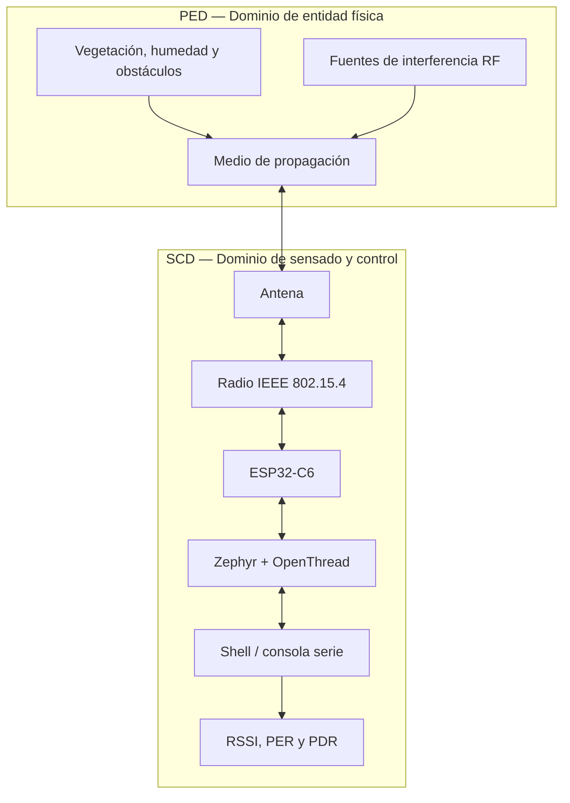

# Laboratorio 1: Caracterización del enlace inalámbrico IEEE 802.15.4 con ESP32-C6 y OpenThread

**Proyecto:** SoilSense — GreenField Technologies  
**Asignatura:** Sistemas IoT  
**Plataforma objetivo:** ESP32-C6  
**Tecnología inalámbrica:** IEEE 802.15.4 / OpenThread  
**Tipo de informe:** Simulación académica  
**Fecha:** 22 de octubre de 2026

> **Advertencia metodológica:** Todos los valores numéricos de RSSI, energía de canal, PER y PDR incluidos en este informe son **datos simulados con fines académicos**. No representan mediciones realizadas con placas físicas ni demuestran el rendimiento real de un equipo. El procedimiento se presenta como metodología propuesta para una futura validación experimental.

---

## 1. Descripción del dispositivo y objetivos

### 1.1 Introducción

Los sistemas de Internet de las Cosas (IoT) destinados a aplicaciones agrícolas requieren enlaces inalámbricos capaces de transportar información con bajo consumo energético y una tasa de entrega de paquetes suficientemente alta. En el proyecto SoilSense, estos enlaces permiten conectar nodos distribuidos en un terreno para intercambiar datos de sensores y apoyar la supervisión de las condiciones ambientales.

Este laboratorio plantea la caracterización de un enlace basado en IEEE 802.15.4 en la banda de 2,4 GHz, utilizando dos placas ESP32-C6 y la pila de comunicación OpenThread. Se consideran tres variables principales: la intensidad de señal recibida (RSSI), la tasa de pérdida de paquetes (PER) y el nivel de energía detectado en los canales disponibles.

### 1.2 Objetivo general

Evaluar, mediante un conjunto de datos simulado, el comportamiento de un enlace IEEE 802.15.4 con OpenThread y establecer criterios preliminares para la selección de canal, el alcance operativo y la fiabilidad de comunicación de una red IoT agrícola.

### 1.3 Objetivos específicos

- Comparar los niveles de energía estimados en los 16 canales IEEE 802.15.4 comprendidos entre el 11 y el 26.
- Analizar la variación del RSSI con la distancia entre dos nodos.
- Calcular PER y PDR para determinar qué distancias cumplen con una tasa de entrega de al menos el 99 %.
- Identificar los factores físicos que afectan la propagación y la fiabilidad del enlace.
- Relacionar los elementos del sistema con los dominios arquitectónicos pertinentes de ISO/IEC 30141.
- Elaborar recomendaciones preliminares para el despliegue y la validación futura de SoilSense.

### 1.4 Equipos y parámetros de referencia

| Parámetro | Configuración planteada |
|---|---|
| Nodos de comunicación | 2 placas ESP32-C6 |
| Estándar de radio | IEEE 802.15.4 |
| Pila de red | OpenThread sobre Zephyr |
| Banda de operación | 2,4 GHz |
| Potencia de transmisión de referencia | 0 dBm |
| Canales evaluados | 11–26 |
| Tiempo de escaneo por canal | 500 ms |
| Paquetes por dirección y distancia | 100 |
| Tamaño de paquete | 64 bytes |
| Intervalo entre paquetes | 0,2 s |
| Distancias simuladas | 1, 5, 10, 15, 20, 25, 30, 40 y 50 m |
| Entorno de propagación supuesto | Línea de vista despejada (LOS) |

La potencia de transmisión de 0 dBm equivale a 1 mW. Se mantiene constante en todo el escenario para que la variación del RSSI se pueda relacionar principalmente con la distancia y con las fluctuaciones hipotéticas del canal.

### 1.5 Métricas de evaluación

La tasa de pérdida de paquetes se calcula como:

\[
PER(\%)=\frac{N_{tx}-N_{rx}}{N_{tx}}\times100
\]

Donde:

- \(N_{tx}\): cantidad de paquetes transmitidos.
- \(N_{rx}\): cantidad de paquetes recibidos correctamente.

El porcentaje de entrega de paquetes es:

\[
PDR(\%)=100-PER(\%)
\]

Con una muestra de 100 paquetes, perder un paquete equivale a un PER del 1 %. Por esta razón, es necesario diferenciar dos criterios:

- **Entrega de al menos el 99 %:** \(PDR\geq99\%\), equivalente a \(PER\leq1\%\).
- **Pérdida inferior al 1 %:** \(PER<1\%\), que en una muestra de 100 paquetes exige cero pérdidas.

El RSSI se expresa en dBm. Un valor más próximo a cero, como −55 dBm, representa una señal recibida más intensa que −75 dBm. Sin embargo, el RSSI por sí solo no permite determinar la calidad total del enlace, ya que también influyen el ruido, la interferencia y las condiciones de propagación.

---

## 2. Resumen para los interesados

### 2.1 Resumen técnico

El escenario simulado presenta al canal 25 como el candidato con menor energía detectada, con un valor de −95 dBm. Bajo las condiciones planteadas, la comunicación conserva una pérdida del 0 % en ambos sentidos hasta los 20 m. A 25 m, el enlace presenta una pérdida del 0 % en una dirección y del 1 % en la contraria; por tanto, cumple el criterio de entrega mínima del 99 %, pero no el criterio más estricto de PER inferior al 1 % en ambas direcciones.

El RSSI asociado con el límite de entrega del 99 % se sitúa aproximadamente en −68 dBm en este conjunto simulado. Se recomienda utilizar ese valor como referencia inicial de diseño y no como umbral universal: deberá verificarse experimentalmente bajo diferentes condiciones ambientales, orientaciones y niveles de interferencia.

### 2.2 Resumen de planificación para el despliegue

El escenario favorece inicialmente el canal 25 y sugiere una separación conservadora de 15 m para un despliegue en línea de vista. Aunque los datos simulados indican que podría mantenerse una entrega de al menos el 99 % hasta los 25 m, la recomendación de 15 m reserva margen frente a la vegetación, la humedad, las variaciones de antena y los obstáculos.

Para una parcela cuadrada de 10 hectáreas y una cuadrícula geométrica de 15 m, se estima un máximo de planificación aproximado de 529 posiciones. Con un coste hipotético de USD 40 por nodo, el presupuesto inicial sería de USD 21 160. Esta cifra es una estimación geométrica, no un diseño definitivo de red: deberá revisarse según la ubicación real de los sensores, la topología Thread y las necesidades de cobertura.

**Recomendación preliminar:** avanzar a una fase piloto controlada, sin autorizar todavía una compra masiva basada únicamente en resultados simulados.

### 2.3 Instrucciones operativas

Antes de instalar un nodo, se deberá comprobar que los dispositivos utilizan el mismo canal y los parámetros compatibles de la red Thread. También se deberá verificar el estado de unión, la estabilidad de alimentación, la orientación de las placas y la calidad del enlace. Si la pérdida de paquetes aumenta, conviene repetir la prueba de energía, reducir temporalmente la distancia y registrar RSSI y PER en ambos sentidos.

---

## 3. ADR-001 — Selección del canal de operación

### 3.1 Contexto

La banda de 2,4 GHz es compartida por diferentes tecnologías inalámbricas, incluidas Wi-Fi, Bluetooth e IEEE 802.15.4. Por ello, seleccionar un canal no consiste solamente en elegir una frecuencia permitida: también es necesario considerar el nivel de energía detectado y verificar posteriormente el desempeño real del enlace.

En el escenario simulado, se supone que el nodo A ejecuta un escaneo pasivo de energía durante 500 ms por canal, desde el canal 11 hasta el 26. Los niveles siguientes son valores ilustrativos creados para el análisis.

### 3.2 Resultados simulados del escaneo

| Canal IEEE 802.15.4 | Energía simulada (dBm) | Interpretación inicial |
|---:|---:|---|
| 11 | −81 | Energía relativamente elevada |
| 12 | −83 | Energía moderada-alta |
| 13 | −85 | Energía moderada |
| 14 | −89 | Energía baja |
| 15 | −92 | Energía baja; candidato alternativo |
| 16 | −87 | Posible influencia de Wi-Fi |
| 17 | −85 | Posible influencia de Wi-Fi |
| 18 | −84 | Posible influencia de Wi-Fi |
| 19 | −88 | Energía baja |
| 20 | −93 | Candidato favorable |
| 21 | −86 | Posible influencia de Wi-Fi |
| 22 | −83 | Energía moderada-alta |
| 23 | −82 | Energía relativamente elevada |
| 24 | −85 | Energía moderada |
| **25** | **−95** | **Menor energía simulada** |
| 26 | −91 | Energía baja; candidato alternativo |

Estos valores representan niveles hipotéticos detectados durante un escaneo. No constituyen una medición del ruido térmico ni una descripción real del espectro en una ubicación concreta.

### 3.3 Decisión arquitectónica

**ADR-001: seleccionar el canal 25 como candidato inicial para el escenario simulado.**

El canal 25 se selecciona porque presenta el nivel de energía simulada más bajo, de −95 dBm. El canal 20 (−93 dBm) y el canal 15 (−92 dBm) se mantienen como alternativas que podrían evaluarse si el canal seleccionado no ofrece un rendimiento satisfactorio.

Un canal con menor energía detectada puede ofrecer condiciones más favorables para la comunicación, pero no garantiza automáticamente un menor PER. La decisión definitiva debe contrastarse con pruebas de paquetes, pues una fuente de interferencia intermitente puede no aparecer durante una ventana de escaneo breve.

La frecuencia central de cada canal IEEE 802.15.4 en 2,4 GHz puede aproximarse mediante:

\[
f_c(\text{MHz})=2405+5(k-11)
\]

donde \(k\) es el número de canal. Para el canal 25:

\[
f_c=2405+5(25-11)=2475\text{ MHz}
\]

Para el canal 20:

\[
f_c=2405+5(20-11)=2450\text{ MHz}
\]

La proximidad espectral con Wi-Fi depende del canal Wi-Fi, el ancho de banda utilizado y la distribución real de la energía. Por tanto, la tabla sirve como punto de partida para evaluar candidatos, no como prueba definitiva de ausencia de interferencia.

### 3.4 Condiciones de aceptación de la decisión

El canal 25 deberá mantenerse únicamente si, durante una prueba física posterior:

1. Ambos nodos pueden unirse a la misma red Thread.
2. La comunicación funciona en ambas direcciones.
3. El PER satisface el objetivo establecido para las distancias de diseño.
4. No se observa una degradación relevante bajo la carga y las condiciones de interferencia esperadas.
5. La prueba se repite en diferentes momentos para descartar que el resultado dependa de una ventana de escaneo excepcionalmente favorable.

---

## 4. Mapeo arquitectónico según ISO/IEC 30141

### 4.1 Propósito del mapeo

ISO/IEC 30141 proporciona una arquitectura de referencia para sistemas IoT. En este laboratorio se utiliza como marco conceptual para organizar los elementos físicos y de procesamiento involucrados en la comunicación. La correspondencia presentada es una interpretación académica de los dominios relevantes, no una certificación de conformidad con la norma.

El análisis se concentra en dos dominios:

- **PED — Physical Entity Domain:** representa el entorno físico que interactúa con el sistema, incluido el medio por el que se propagan las ondas y las condiciones ambientales que afectan el enlace.
- **SCD — Sensing and Controlling Domain:** representa los elementos que participan en la adquisición de información, el control y la interacción con el sistema físico, incluyendo el hardware de procesamiento y las interfaces de comunicación.

### 4.2 Tabla de correspondencia

| Elemento del sistema | Dominio asociado | Función en el laboratorio | Estado en el escenario |
|---|---|---|---|
| Aire y medio de propagación | PED | Permite la propagación de las ondas electromagnéticas | Condición física representada |
| Vegetación, humedad y obstáculos | PED | Pueden introducir atenuación y desvanecimiento | Variables ambientales consideradas, no medidas |
| Fuentes de interferencia en 2,4 GHz | PED | Pueden elevar la interferencia efectiva y afectar la recepción | Representadas mediante datos de energía simulados |
| Antena de cada placa | SCD, como interfaz física del dispositivo | Transmite y recibe la señal RF | Componente supuesto en funcionamiento |
| Transceptor IEEE 802.15.4 | SCD | Gestiona las funciones de radio y acceso al medio | Operación planteada |
| MCU ESP32-C6 | SCD | Ejecuta el firmware y procesa los comandos | Plataforma objetivo del laboratorio |
| Zephyr y OpenThread | Capa de software asociada al dispositivo | Gestionan el sistema operativo y la comunicación Thread | Entorno de software objetivo |
| Consola serie y shell | Interfaz de gestión | Permiten configurar y consultar el estado de los nodos | Instrumentación prevista |
| Registros RSSI, PER y PDR | Información de observabilidad | Permiten evaluar la calidad del enlace | Valores simulados para este informe |

### 4.3 Diagrama conceptual

El diagrama muestra que el rendimiento del enlace no depende únicamente del software. La propagación, la antena, las condiciones del entorno y la radio forman parte de una cadena que condiciona la calidad de la comunicación. El software permite configurar la red y observar sus resultados, pero no elimina las limitaciones físicas del canal.

### 4.4 Capacidades del dispositivo

La siguiente tabla distingue entre capacidades previstas en la plataforma y capacidades demostradas por los datos simulados. Una simulación numérica no valida por sí misma la operación física de un componente.

| Categoría | Capacidad | Clasificación en el informe |
|---|---|---|
| Transducer / actuación | LED integrado como indicador de estado | Capacidad posible; no evaluada por los datos |
| Data | Transmisión y recepción de paquetes IEEE 802.15.4 | Función central modelada |
| Data | Lectura de RSSI y cálculo de PER/PDR | Métricas analizadas mediante datos simulados |
| Interface | Shell OpenThread y consola serie | Interfaz prevista para el procedimiento |
| Supporting | Sincronización temporal y mecanismos criptográficos de la pila | Funciones de soporte; no evaluadas |
| Latent | Wi-Fi y Bluetooth LE disponibles en la plataforma | Fuera del alcance de la prueba |
| Supporting | USB para alimentación y depuración | Medio de conexión previsto; no evaluado |

**Nota:** la clasificación como activa, latente o de soporte no debe interpretarse como una comprobación física del hardware. Para asignar el estado “activo y validado” se requeriría ejecutar y documentar la función sobre las placas reales.

---

## 5. Fundamento físico y análisis técnico

### 5.1 ¿Por qué disminuye el RSSI cuando aumenta la distancia?

En condiciones ideales de espacio libre, la energía de una señal electromagnética se distribuye sobre una superficie cada vez mayor a medida que se aleja de la antena transmisora. Por ello, la potencia recibida disminuye con la distancia.

La pérdida de trayecto en espacio libre puede aproximarse mediante:

\[
PL(d)=20\log_{10}\left(\frac{4\pi d}{\lambda}\right)
\]

donde \(d\) es la distancia y \(\lambda\) la longitud de onda. A una frecuencia fija, duplicar la distancia aumenta la pérdida de trayecto aproximadamente 6 dB en el modelo de espacio libre.

En un entorno agrícola, la vegetación, el suelo, las estructuras, la humedad y las reflexiones pueden provocar desviaciones respecto al modelo ideal. También pueden aparecer desvanecimientos por interferencia entre varias trayectorias de la señal. En consecuencia, la tendencia esperada es que el RSSI disminuya con la distancia, aunque los valores reales no tienen que cambiar de forma perfectamente uniforme.

### 5.2 ¿Por qué una señal detectable no garantiza una entrega del 99 %?

La sensibilidad del receptor indica el nivel mínimo de señal bajo unas condiciones especificadas de funcionamiento y tasa de error. No implica que cualquier señal superior a ese nivel produzca una comunicación fiable.

La calidad del enlace también depende de la relación señal-interferencia más ruido, la modulación, la codificación, los mecanismos de retransmisión disponibles y la variación temporal del canal. Una señal puede ser detectable y, aun así, presentar pérdidas si la interferencia o el desvanecimiento impiden demodular correctamente algunos paquetes.

Por ello, el umbral de RSSI de este escenario se interpreta como una **referencia operativa simulada**, no como la sensibilidad oficial del ESP32-C6. La validación debe relacionar RSSI con PER mediante muestras suficientemente grandes y pruebas repetidas.

### 5.3 ¿Cómo ayuda DSSS frente a ciertas interferencias?

En la banda de 2,4 GHz, IEEE 802.15.4 utiliza una forma de espectro ensanchado por secuencia directa (DSSS) con modulación O-QPSK. En esta técnica, los símbolos se representan mediante secuencias de chips, lo que proporciona propiedades de procesamiento que ayudan a recuperar la señal en presencia de determinados tipos de interferencia.

No obstante, DSSS no elimina todas las interferencias. Una señal Wi-Fi intensa y parcialmente solapada puede degradar la recepción, elevar la tasa de errores o generar pérdidas de paquetes. La selección de canal, la separación física de las fuentes interferentes y un margen de enlace adecuado continúan siendo necesarios.

### 5.4 Presupuesto de enlace conceptual

Una forma simplificada de representar el enlace es:

\[
P_{RX}=P_{TX}+G_{TX}+G_{RX}-PL
\]

donde:

- \(P_{RX}\) es la potencia recibida, en dBm.
- \(P_{TX}\) es la potencia transmitida, en dBm.
- \(G_{TX}\) y \(G_{RX}\) son las ganancias de las antenas, en dBi.
- \(PL\) es la pérdida de trayecto, en dB.

Para el escenario se plantea \(P_{TX}=0\text{ dBm}\). No se asignan ganancias exactas a las antenas integradas ni se pretende deducir un presupuesto de enlace validado, porque sus valores efectivos dependen de la placa, la orientación y el entorno.

El margen de enlace puede expresarse conceptualmente como:

\[
M=P_{RX}-P_{\text{mínimo requerido}}
\]

Un margen positivo y suficientemente amplio ayuda a tolerar desvanecimientos e interferencia. El valor necesario depende de los requisitos de fiabilidad y de las condiciones ambientales; no puede establecerse con certeza usando únicamente los datos simulados.

---

## 6. Metodología del experimento

### 6.1 Diseño de la prueba

El procedimiento se estructura en tres fases: caracterización inicial del entorno radioeléctrico, configuración de la red Thread y evaluación de la comunicación a diferentes distancias.

Para reproducir el experimento físicamente se necesitarían dos placas ESP32-C6 compatibles, una versión de Zephyr que soporte la placa elegida, OpenThread habilitado y un entorno donde sea posible medir las distancias y mantener condiciones de prueba comparables.

Los resultados numéricos presentados en la sección siguiente son simulados; el procedimiento se describe como método propuesto para una futura validación.

### 6.2 Preparación del sistema

1. Conectar cada ESP32-C6 a un puerto USB y abrir una consola serie independiente.
2. Verificar que el firmware de Zephyr y la configuración de OpenThread correspondan a la placa y a la versión instalada.
3. Confirmar que la consola permite consultar el estado de la interfaz de red y ejecutar los comandos admitidos por esa compilación.
4. Reiniciar la configuración de red de prueba si es necesario, evitando reutilizar datasets incompatibles.
5. Registrar la versión del firmware, la potencia de transmisión, la configuración de radio y las condiciones ambientales.

Los comandos exactos pueden variar según la versión de Zephyr, el shell habilitado y la integración de OpenThread. Antes de utilizarlos, se debe comprobar que la compilación dispone de los comandos correspondientes.

### 6.3 Escaneo de energía

En el nodo A se propone activar la interfaz de radio y ejecutar el escaneo de energía de los canales 11–26, utilizando la duración disponible en la versión del comando. Para este escenario se adopta una ventana nominal de 500 ms por canal.

El operador debe registrar el nivel de energía que reporte el sistema para cada canal, sin confundirlo con una medición calibrada de ruido. Después se selecciona el canal candidato y se comprueba que el enlace realmente funciona en él.

**Precaución:** el escaneo de energía no requiere transmitir paquetes de interferencia. El procedimiento debe ser pasivo y limitarse a observar el entorno RF.

### 6.4 Configuración de OpenThread

Una vez seleccionado el canal, se plantea el siguiente flujo de configuración:

1. Configurar una potencia de transmisión de referencia de 0 dBm, si la plataforma y el firmware permiten establecerla.
2. Crear un conjunto de datos Thread válido en el nodo A y asignarle el canal de prueba.
3. Aplicar el conjunto de datos e iniciar Thread en el nodo A.
4. Incorporar el nodo B utilizando los parámetros de red correspondientes.
5. Esperar a que ambos nodos se incorporen correctamente y comprobar sus direcciones IPv6 y su estado.
6. Registrar el canal efectivo y confirmar que la comunicación funciona antes de iniciar la prueba de distancia.

No se debe copiar una clave de red real en un informe público. En una práctica académica, basta con indicar que se usó un dataset de laboratorio y omitir sus credenciales.

### 6.5 Medición de distancia y paquetes

Para cada distancia de la tabla, se propone mantener los nodos a una altura y orientación constantes, con línea de vista despejada. Se enviarán 100 paquetes de prueba en una dirección y luego se repetirá el ensayo en la dirección contraria.

En cada sentido se registrarían:

- RSSI promedio reportado para los paquetes recibidos.
- Número de paquetes transmitidos.
- Número de paquetes recibidos correctamente.
- Número de paquetes perdidos.
- PER y PDR calculados.
- Observaciones sobre la posición de las placas y el entorno.

El procedimiento debe repetirse en condiciones equivalentes. Si se realizan pruebas con vegetación o con obstáculos, esos resultados deben registrarse por separado y no mezclarse con la serie de línea de vista.

### 6.6 Variables controladas y limitaciones

| Variable | Tratamiento en el escenario |
|---|---|
| Potencia TX | Fijada nominalmente en 0 dBm |
| Canal | Se mantiene el canal 25 después de la selección simulada |
| Tamaño de paquete | 64 bytes |
| Número de paquetes | 100 por sentido y distancia |
| Intervalo | 0,2 s entre paquetes |
| Distancia | Variable independiente |
| Orientación de antenas | Supuesta constante |
| Interferencia y ambiente | No medidos; representados de forma hipotética |
| Repeticiones | No ejecutadas físicamente |

---

## 7. Resultados simulados: distancia, RSSI, PER y PDR

### 7.1 Tabla principal de resultados

> **Todos los valores de esta tabla son simulados.** Cada PER se interpreta sobre 100 paquetes por sentido, por lo que un punto porcentual equivale a un paquete perdido.

| Distancia (m) | RSSI A→B (dBm) | RSSI B→A (dBm) | PER A→B (%) | PER B→A (%) | PDR A→B (%) | PDR B→A (%) |
|---:|---:|---:|---:|---:|---:|---:|
| 1 | −41 | −43 | 0 | 0 | 100 | 100 |
| 5 | −48 | −50 | 0 | 0 | 100 | 100 |
| 10 | −54 | −56 | 0 | 0 | 100 | 100 |
| 15 | −59 | −61 | 0 | 0 | 100 | 100 |
| 20 | −63 | −65 | 0 | 0 | 100 | 100 |
| 25 | −66 | −68 | 0 | 1 | 100 | 99 |
| 30 | −72 | −74 | 3 | 5 | 97 | 95 |
| 40 | −78 | −80 | 14 | 18 | 86 | 82 |
| 50 | −84 | −86 | 31 | 35 | 69 | 65 |

### 7.2 Cálculo detallado a 25 metros

Para la dirección A→B, el escenario considera que se transmitieron 100 paquetes y se recibieron correctamente 100.

\[
PER_{A\rightarrow B}=\frac{100-100}{100}\times100=0\%
\]

\[
PDR_{A\rightarrow B}=100-0=100\%
\]

Para la dirección B→A, se reciben correctamente 99 de los 100 paquetes:

\[
PER_{B\rightarrow A}=\frac{100-99}{100}\times100=1\%
\]

\[
PDR_{B\rightarrow A}=100-1=99\%
\]

Por tanto, a 25 m el enlace satisface el criterio inclusivo \(PDR\geq99\%\) en ambos sentidos. No satisface el criterio más estricto \(PER<1\%\) en ambos sentidos, porque una dirección presenta exactamente el 1 % de pérdidas.

### 7.3 Cálculo a 30 metros

En A→B se reciben 97 paquetes de 100:

\[
PER_{A\rightarrow B}=\frac{100-97}{100}\times100=3\%
\]

\[
PDR_{A\rightarrow B}=97\%
\]

En B→A se reciben 95 paquetes:

\[
PER_{B\rightarrow A}=\frac{100-95}{100}\times100=5\%
\]

\[
PDR_{B\rightarrow A}=95\%
\]

Esta distancia no cumple el objetivo de entrega mínima del 99 %. La degradación respecto a 25 m es consistente con un enlace que comienza a perder margen bajo las condiciones supuestas.

### 7.4 Interpretación de la tendencia del RSSI

El RSSI disminuye de forma general conforme aumenta la distancia. El escenario también presenta una diferencia de aproximadamente 2 dB entre direcciones, que en un ensayo real podría deberse a orientación de antenas, diferencias entre unidades, multipath o variaciones temporales. En este caso, esa asimetría forma parte de los datos simulados y no constituye una observación física.

### 7.5 Interpretación de PER y PDR

Hasta 20 m no aparecen pérdidas en la muestra simulada. A 25 m se alcanza el límite del criterio del 99 % en una dirección. A partir de 30 m, el PER aumenta y se aleja progresivamente del objetivo. A 40 y 50 m, las pérdidas hipotéticas indican que esas distancias no serían adecuadas para el objetivo de fiabilidad establecido.

Es importante no interpretar los 100 paquetes como garantía estadística de rendimiento futuro. Una muestra tan pequeña tiene una resolución de 1 punto porcentual y puede ocultar pérdidas poco frecuentes. Para una caracterización experimental más sólida convendría utilizar 1 000 paquetes o más por punto, efectuar varias repeticiones y registrar la variabilidad.

### 7.6 Alcance estimado a partir de los datos simulados

| Criterio | Resultado del escenario |
|---|---|
| PER = 0 % en ambos sentidos | Hasta 20 m |
| PDR ≥ 99 % en ambos sentidos | Hasta 25 m |
| PDR ≥ 99 % a 30 m | No se cumple |

Así, el alcance fiable simulado bajo el criterio estricto es de **20 m en línea de vista**. Si se admite una entrega mínima del 99 %, el límite observado en el conjunto de datos se amplía a **25 m**. Para un despliegue agrícola se propone una separación preliminar de **15 m**, como margen conservador frente a condiciones que todavía no han sido modeladas ni verificadas.

---

## 8. Estimación preliminar para un terreno de 10 hectáreas

Una hectárea equivale a \(10\,000\text{ m}^2\). Por tanto:

\[
A=10\times10\,000=100\,000\text{ m}^2
\]

Si se supone una parcela cuadrada, la longitud de cada lado es:

\[
L=\sqrt{100\,000}\approx316.23\text{ m}
\]

Para una separación nominal de 15 m, el número aproximado de intervalos por lado es:

\[
n_{\text{intervalos}}=\left\lceil\frac{316.23}{15}\right\rceil=22
\]

Incluyendo las posiciones de ambos extremos, se estiman 23 posiciones por lado. Para una cuadrícula regular:

\[
N=23\times23=529\text{ posiciones}
\]

Si el coste supuesto de cada nodo es USD 40:

\[
C=529\times40=\text{USD }21\,160
\]

| Indicador | Estimación |
|---|---:|
| Superficie | 10 ha |
| Separación nominal | 15 m |
| Posiciones geométricas estimadas | 529 |
| Coste supuesto por nodo | USD 40 |
| Coste nominal total | USD 21 160 |

Esta estimación representa una cuadrícula geométrica, no una recomendación definitiva de instalar 529 repetidores o routers Thread. La cantidad real dependerá de cuántos nodos necesiten medir variables del suelo, del alcance de cada enlace, de la topología de la red, de la alimentación disponible y de las condiciones del terreno. También deben contemplarse costes de instalación, encapsulado, mantenimiento y alimentación, que no están incluidos en el coste nominal.

---

## 9. Resumen de rendimiento para el responsable del proyecto

| Indicador | Resultado del escenario simulado |
|---|---|
| Canal candidato | 25; energía simulada de −95 dBm |
| Alcance con PER = 0 % en ambos sentidos | 20 m en línea de vista |
| Alcance con PDR ≥ 99 % | 25 m en línea de vista |
| Referencia RSSI para el objetivo del 99 % | Aproximadamente −68 dBm |
| Separación preliminar recomendada | 15 m |
| Canales alternativos | 20 y 15 |
| Posiciones geométricas para 10 ha | 529 |
| Coste supuesto por nodo | USD 40 |
| Coste nominal total | USD 21 160 |
| Veredicto | Avanzar a una prueba piloto; no aprobar aún el despliegue masivo |

### Decisiones recomendadas

1. Validar el canal 25 mediante un escaneo real y pruebas de paquetes.
2. Comprobar el rendimiento a 15, 20 y 25 m en ambos sentidos.
3. Repetir las pruebas con vegetación y obstáculos representativos del terreno.
4. Ajustar la separación de nodos a partir de los resultados medidos y de la topología real.
5. Actualizar el presupuesto cuando se conozcan los requisitos de cobertura y los costes efectivos del hardware.

---

## 10. Lista de verificación de campo

### 10.1 Antes de iniciar la prueba

- [ ] Confirmar que ambas placas sean ESP32-C6 compatibles con IEEE 802.15.4.
- [ ] Verificar que el firmware y la versión de Zephyr correspondan a la placa utilizada.
- [ ] Confirmar que OpenThread está habilitado y que la consola responde.
- [ ] Comprobar la alimentación y la orientación de las antenas.
- [ ] Registrar la fecha, ubicación, distancia, canal y potencia de transmisión.
- [ ] Verificar que los nodos utilicen el mismo dataset de red y canal.

### 10.2 Si un nodo no logra incorporarse a la red

- Verificar que el canal, el dataset y los parámetros de seguridad sean compatibles.
- Consultar el estado de OpenThread y comprobar si el dispositivo está desconectado, unido como *child* o desempeñando otro rol válido.
- Revisar la estabilidad de la alimentación y reiniciar el procedimiento de forma controlada si es necesario.
- Alejar la placa de superficies metálicas que puedan alterar la antena.
- Comprobar que la versión del firmware admite los comandos utilizados.
- No interpretar un fallo de unión como prueba de alcance insuficiente hasta descartar errores de configuración.

### 10.3 Si aumenta la pérdida de paquetes

- Ejecutar nuevamente un escaneo pasivo de energía y comparar los canales candidatos.
- Registrar RSSI y PER por separado para cada sentido.
- Reducir la distancia y repetir la prueba para distinguir entre limitación de alcance e interferencia.
- Mantener un solo flujo de prueba a la vez, evitando tráfico simultáneo innecesario.
- Repetir cada medición y registrar las condiciones ambientales.
- Si la pérdida se mantiene, probar un canal alternativo y documentar el cambio.

### 10.4 Orientación preliminar según el entorno

La siguiente tabla es una guía de ensayo propuesta, no una conclusión obtenida de las tablas simuladas.

| Condición de propagación | Distancia inicial para probar | Acción recomendada |
|---|---:|---|
| Línea de vista despejada | 15 m | Validar RSSI y PER en ambos sentidos |
| Vegetación ligera o cultivos bajos | 10–12 m | Comparar con la prueba de línea de vista |
| Follaje denso u obstáculos importantes | 8–10 m | Evaluar enlaces intermedios y repetir mediciones |

Las distancias menores se plantean como puntos iniciales de evaluación, no como garantías de cobertura. La vegetación puede introducir pérdidas variables según su densidad, humedad, altura y disposición. Por ello, la separación definitiva debe establecerse mediante pruebas en el terreno real.

---

## 11. Limitaciones y trabajo futuro

1. **Datos simulados:** no se ha ejecutado físicamente el experimento. Los valores no permiten afirmar que un ESP32-C6 real alcance 20 o 25 m bajo las condiciones descritas.
2. **Escaneo hipotético:** los niveles de energía se construyeron para representar un escenario plausible. No se dispone de un registro RF real que confirme que el canal 25 sea el menos interferido.
3. **Muestra reducida:** 100 paquetes permiten distinguir pérdidas en pasos de un punto porcentual, pero ofrecen una estimación limitada de la fiabilidad. Para pruebas finales se recomienda aumentar la muestra y realizar repeticiones.
4. **Condiciones ambientales simplificadas:** la tabla de alcance supone línea de vista despejada. No modela explícitamente la humedad, el follaje, las reflexiones o los obstáculos.
5. **Asimetría entre direcciones:** las diferencias de RSSI y PER se introdujeron como variaciones hipotéticas. En un ensayo real deben medirse por separado.
6. **Estimación económica geométrica:** las 529 posiciones y el coste de USD 21 160 dependen de una cuadrícula teórica de 15 m y de un precio unitario supuesto. No incluyen instalación, energía, mantenimiento ni un diseño definitivo de red.

Como trabajo futuro, se propone ejecutar la prueba con dos placas ESP32-C6 reales, guardar los registros de consola, documentar las versiones de software y comparar el comportamiento en línea de vista, vegetación ligera y vegetación densa. También convendría estudiar más de un canal candidato y realizar varias rondas de medición para estimar la variabilidad temporal.

---

## 12. Conclusiones

El escenario simulado permite ilustrar cómo se relacionan la distancia, el RSSI y la pérdida de paquetes en un enlace IEEE 802.15.4. A medida que aumenta la separación entre nodos, la intensidad de señal disminuye y, al acercarse al límite operativo supuesto, la pérdida de paquetes crece. En los datos construidos, el enlace mantiene PER nulo hasta 20 m y alcanza una entrega mínima del 99 % hasta 25 m, mientras que a partir de 30 m ya no cumple ese objetivo.

El escaneo hipotético favorece el canal 25, con un nivel de energía de −95 dBm, aunque la decisión tendría que confirmarse mediante pruebas reales. La separación preliminar de 15 m proporciona un punto conservador para iniciar la validación agrícola, pero no garantiza el rendimiento en presencia de vegetación u obstáculos.

El mapeo conceptual de ISO/IEC 30141 permite diferenciar el entorno físico de propagación y los componentes de sensado, control y comunicación. Finalmente, la estimación de 529 posiciones para 10 hectáreas muestra la importancia de combinar las necesidades de cobertura con la topología de la red y el coste de despliegue. En conjunto, el informe constituye una base académica para planificar el experimento, no una certificación del rendimiento del sistema SoilSense.

---

## 13. Referencias

1. Guía de laboratorio. *Lab 1: Testing Your Wireless Radio — GreenField Technologies, SoilSense*. Material de la asignatura.
2. Zephyr Project. *Getting Started Guide*. https://docs.zephyrproject.org/latest/develop/getting_started/index.html
3. Zephyr Project. *ESP32-C6-DevKitC board*. https://docs.zephyrproject.org/latest/boards/espressif/esp32c6_devkitc/doc/index.html
4. OpenThread. *CLI Reference*. https://openthread.io/reference/cli/commands
5. ISO/IEC. *ISO/IEC 30141 — Internet of Things (IoT): Reference Architecture*. Norma utilizada como marco conceptual para la organización arquitectónica del sistema.

---

**Nota final:** Mantener la etiqueta “datos simulados” en la portada, en la sección de resultados y en el resumen ejecutivo. Si el docente exige mediciones experimentales, este documento debe presentarse como análisis preliminar y las tablas simuladas deben sustituirse por registros obtenidos al ejecutar la prueba con dos ESP32-C6.
